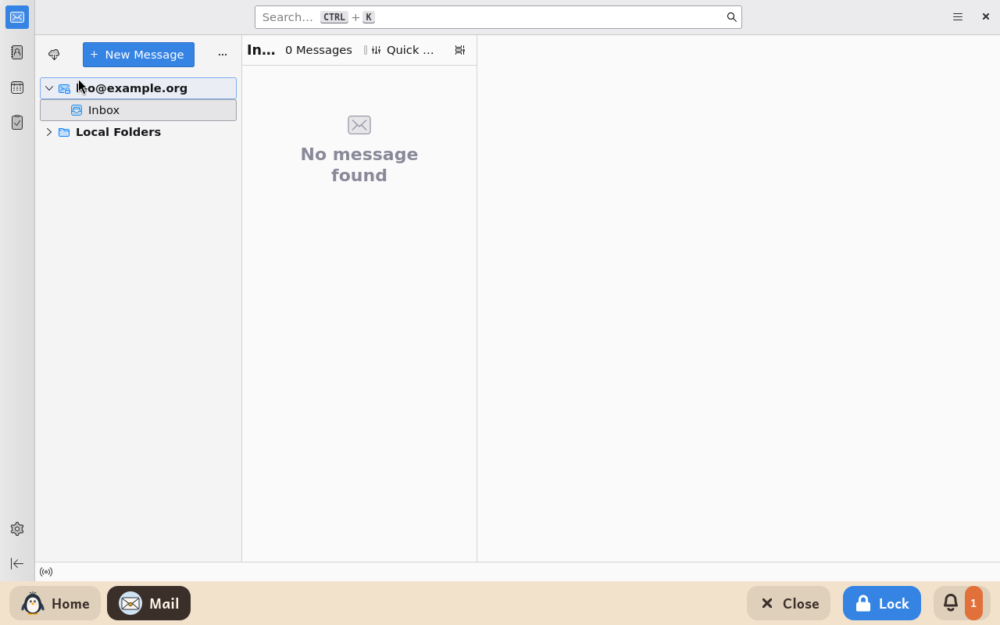
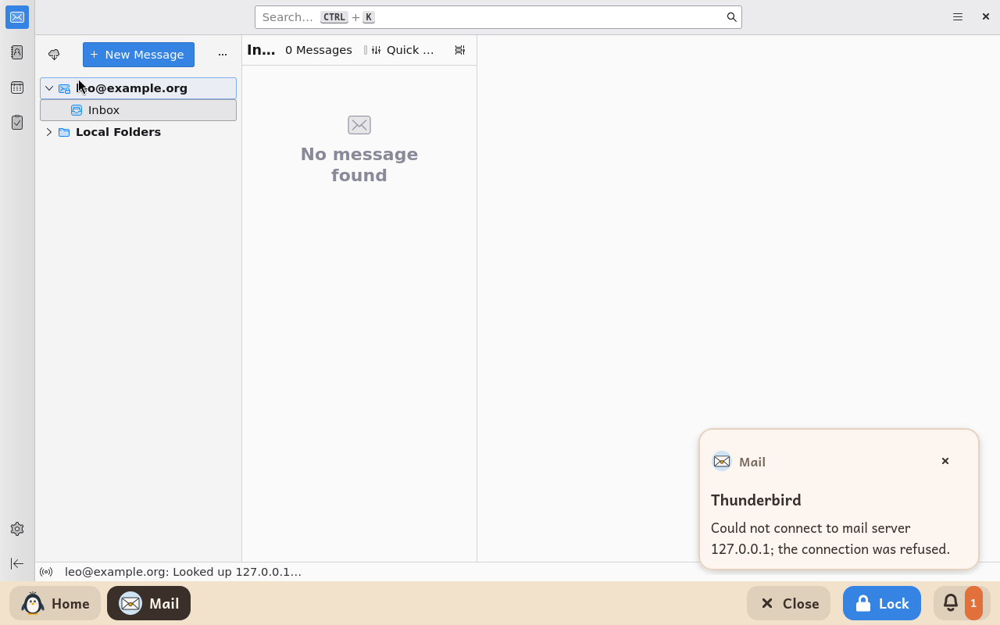

# Messagerie

*[English version](../../en/modules/mail.md) · [Versión en español](../../es/modules/mail.md)* · [Retour au guide d'utilisation](../user-guide.md#9-modules-dapprentissage)

**Messagerie** est un client de messagerie adapté aux enfants, basé sur Mozilla Thunderbird. Il leur donne une boîte aux lettres sûre et simplifiée pour lire et écrire des e-mails, sans avoir à configurer de réglages réseau compliqués, puisque les informations du compte sont gérées par les adultes dans l'espace adulte.

| | |
|---|---|
| **Âge recommandé** | À partir de 8 ans |
| **Connexion à Internet** | Nécessaire pour synchroniser, envoyer et recevoir les messages ; fonctionne avec Gmail, Outlook, iCloud ou tout fournisseur IMAP |
| **Logiciel utilisé** | [Thunderbird](https://www.thunderbird.net/), développé par MZLA Technologies et la communauté Mozilla sous licence MPL-2.0, empaqueté depuis Debian |

## Ce que c'est et comment ça marche

Kidux adapte Thunderbird pour ne garder que l'essentiel de la messagerie : les enfants ont un accès clair à leur boîte de réception, à la liste des messages et à la rédaction, tandis que les fonctions superflues (comme les réseaux de tchat publics, les magasins d'extensions, la navigation web complète et les menus de configuration avancée) sont entièrement désactivées.

## Les réglages pour l'adulte

Les adultes configurent la boîte aux lettres dans la page **Modules** de l'espace adulte :

| Réglage | Description |
|---|---|
| **Adresse e-mail** | L'adresse e-mail de l'enfant. Messagerie détecte automatiquement les serveurs des fournisseurs courants (Gmail, Outlook/Hotmail, iCloud, Yahoo, etc.). |
| **Nom** | Le nom d'expéditeur que voient les destinataires des messages envoyés. |
| **Serveur entrant** | Nécessaire seulement si la détection automatique échoue : le serveur IMAP du fournisseur (par exemple `imap.example.org`, ou avec le port `imap.example.org:993`). |
| **Serveur sortant** | L'adresse du serveur SMTP sortant du fournisseur (par exemple `smtp.example.org:465`). |

Une fois les réglages enregistrés dans l'espace adulte, un adulte devrait accompagner l'enfant au premier lancement :
- **Comptes Google ou Microsoft** : une fenêtre de connexion intégrée s'ouvre pour saisir les identifiants et valider la double authentification si elle est activée.
- **Autres fournisseurs** : une seule demande de mot de passe apparaît ; cochez la case pour retenir le mot de passe afin qu'il soit gardé durablement.

Thunderbird garde le mot de passe de la boîte aux lettres dans le profil propre à l'enfant. L'espace adulte de Kidux ne voit ni ne garde jamais les mots de passe de messagerie.

## À savoir

- **Comptes supervisés par Google Family Link** : les enfants de moins de treize ans dont le compte Google est supervisé avec Family Link ne peuvent pas se connecter à des clients de messagerie comme Thunderbird. Utilisez le module [Gmail](gmail.md) pour ces comptes.
- **Configuration imposée** : toute modification manuelle des comptes, ou toute adresse secondaire ajoutée à la main, est annulée à chaque redémarrage de Messagerie ; la configuration reflète toujours strictement l'espace adulte. Si aucune adresse n'est indiquée dans l'espace adulte, Messagerie s'ouvre avec seulement des dossiers locaux, non connectés.
- **Liens et pièces jointes sûrs** : les liens dans le corps des messages sont désactivés, pour éviter toute navigation sur des sites non fiables. Les pièces jointes reçues sont enregistrées en sécurité dans le dossier **Téléchargements** de l'enfant, sans jamais être ouvertes automatiquement.
- **Messages sur l'état de la connexion** : si le serveur de messagerie est injoignable ou que la connexion à Internet est coupée, un message discret apparaît au-dessus de la barre et dans la barre d'état de la fenêtre.

