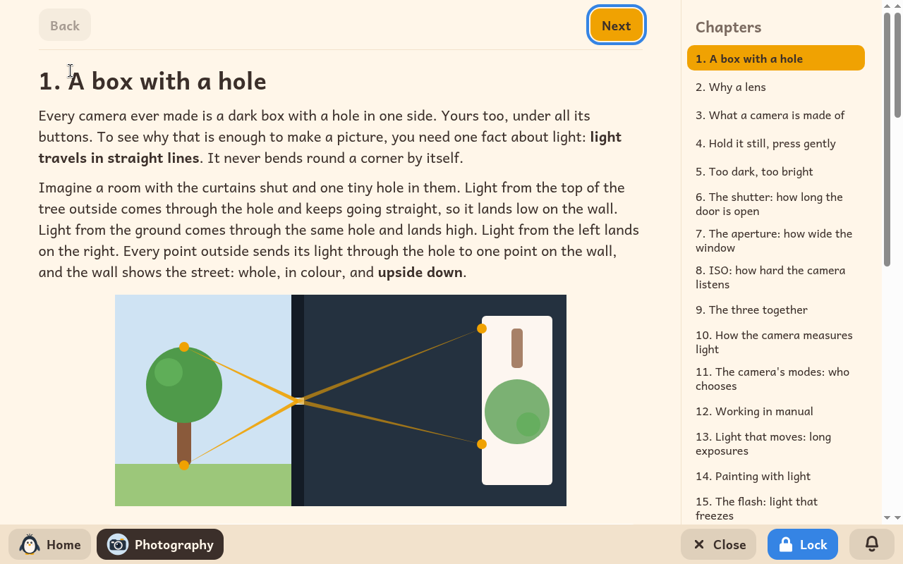

# Photographie

*[English version](../../en/modules/photography.md) · [Versión en español](../../es/modules/photography.md)* · [Retour au guide d'utilisation](../user-guide.md#9-modules-dapprentissage)

**Photographie** est un cours illustré et pratique qui apprend aux enfants à prendre des photos avec un vrai appareil : comprendre comment fonctionne l'appareil, le tenir bien stable, et maîtriser l'exposition, la mise au point et la composition.

| | |
|---|---|
| **Âge recommandé** | Enfants de 8 à 12 ans qui lisent avec aisance |
| **Matériel nécessaire** | Un appareil photo numérique (compact, bridge, hybride ou reflex), et aucune connexion à Internet |
| **Supports pédagogiques** | Réalisés par Kidux. Ils comprennent des photographies pédagogiques publiées sous licences libres et des illustrations explicatives créées par ordinateur, clairement signalées. |

## Ce que c'est et comment ça marche

Le guide est conçu pour fonctionner avec n'importe quel appareil doté d'une molette de modes manuels ou créatifs, et peut même servir avec l'appareil photo d'un téléphone pour apprendre les notions de base. Comme exemple concret et constant, les leçons s'appuient sur le compact expert Olympus XZ-2 : un encadré dédié (**Sur l'appareil Olympus XZ-2**) dans chaque chapitre explique exactement quelle molette ou quel bouton utiliser, en signalant les noms que donnent d'autres fabricants à la même chose.

Chaque chapitre associe des principes théoriques concis à des photos d'exemple, des schémas de ce que montre l'écran de l'appareil et un exercice pratique (**Essaie**) à faire tout de suite avec l'appareil. De plus, un encadré pour l'adulte (**Pour l'adulte**) propose des activités à faire ensemble (comme préparer une pièce sombre, utiliser une lampe de poche, explorer le flash ou photographier dehors au crépuscule).

## Les trente chapitres

1. Une boîte avec un trou
2. Pourquoi un objectif
3. De quoi est fait un appareil photo
4. Bien le tenir, appuyer doucement
5. Trop sombre, trop clair
6. L'obturateur : combien de temps la porte reste ouverte
7. L'ouverture : la taille de la fenêtre
8. La sensibilité ISO : à quel point l'appareil tend l'oreille
9. Les trois ensemble
10. Comment l'appareil mesure la lumière
11. Les modes de l'appareil : qui choisit
12. Travailler en manuel
13. La lumière qui bouge : les poses longues
14. Peindre avec la lumière
15. Le flash : la lumière qui fige
16. La mise au point : où regarde l'appareil
17. Les modes de mise au point : une fois, en suivant, à la main
18. La profondeur de champ : ce qui est net
19. De très près : la macro
20. Le zoom : près et loin, et ce qu'il fait aux visages
21. Où placer les choses : la règle des tiers
22. Lignes, cadres et motifs
23. Les arrière-plans, et faire le ménage
24. Le point de vue
25. La lumière a une heure et un côté
26. La couleur, et le noir et blanc
27. Les personnes et les moments
28. Regarder ses photos
29. Choisir, et raconter une histoire
30. Les mots de la photographie

## À savoir

Les leçons et les guides interactifs se lisent sur l'ordinateur, tandis que les exercices pratiques de photographie se font avec un vrai appareil, loin de l'écran. Le module ne laisse pas de fichiers de projet éparpillés dans le dossier personnel de l'enfant.
