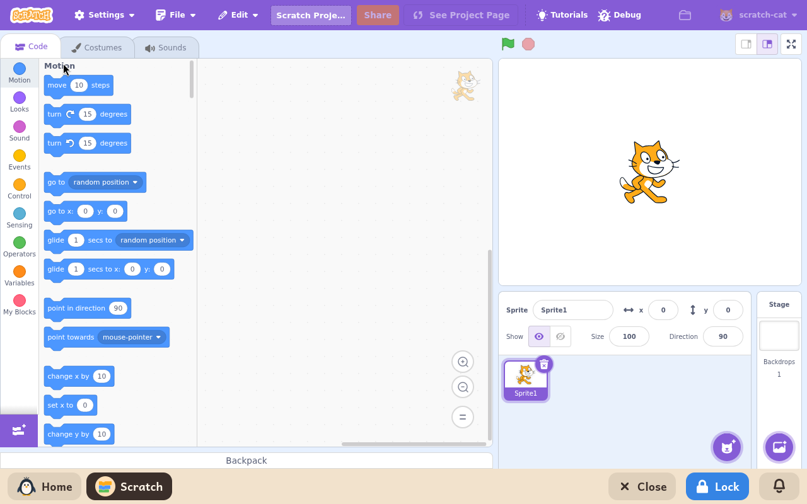

# Scratch

*[English version](../../en/modules/scratch.md) · [Versión en español](../../es/modules/scratch.md)* · [Retour au guide d'utilisation](../user-guide.md#9-modules-dapprentissage)

**Scratch** est le célèbre environnement de programmation visuelle par blocs développé par le MIT Media Lab et la Scratch Foundation. Il permet de créer des jeux vidéo interactifs, des histoires animées et des simulations en assemblant des blocs de code colorés.

| | |
|---|---|
| **Âge recommandé** | Enfants et adolescents de 8 à 16 ans |
| **Recommandé avant** | ScratchJr |
| **Connexion à Internet** | Facultative (elle ne sert qu'à télécharger les médias de la bibliothèque officielle de lutins, d'arrière-plans et de sons ; programmer, modifier et lancer les projets fonctionne entièrement hors ligne) |
| **Logiciel utilisé** | [Scratch Desktop](https://scratch.mit.edu/), développé par la Scratch Foundation sous licence AGPL-3, compilé par Kidux pour fonctionner en local |

## Ce que c'est et comment ça marche

Kidux fait tourner l'éditeur de bureau officiel de Scratch, complet, en local sur la machine, dans la langue choisie pour l'enfant. Pour protéger la vie privée de l'enfant et éviter les distractions en ligne, les fonctions de réseau social public du site de Scratch sont retirées : les projets ne sont pas publiés sur Internet, et personne de l'extérieur ne peut contacter l'enfant.

L'espace de travail contient tous les outils habituels de Scratch : la scène en temps réel, les listes de lutins et d'arrière-plans, toutes les palettes de blocs (mouvement, apparence, son, événements, contrôle, capteurs, opérateurs, variables et blocs personnalisés), et les éditeurs intégrés de costumes, en bitmap ou en vectoriel, et de sons.

## Les fonctionnalités

- **Éditeur visuel complet** : tous les blocs habituels de Scratch, la gestion des calques et les effets sonores.
- **Bibliothèque de médias** : les lutins, arrière-plans et enregistrements d'instruments officiels, mis en cache en toute sécurité depuis les serveurs de Scratch quand on parcourt la galerie.
- **Éditeurs créatifs** : une zone de dessin vectoriel intégrée pour créer ses propres lutins et arrière-plans, et un enregistreur de sons par le micro.
- **Cartes de tutoriels guidés** : des cartes de projets illustrées, étape par étape, qui guident les débutants dans l'animation et les mécanismes de jeu. Leurs vidéos ne se lisent pas, car elles sont sur un site web, et un module ne montre que ses propres pages.

## Enregistrer et ouvrir des projets

Pour enregistrer un projet, cliquez sur **Fichier > Sauvegarder sur votre ordinateur**. Une fenêtre de choix de fichier s'ouvre pour choisir un dossier et un nom de fichier dans le dossier personnel de l'enfant. Pour reprendre un fichier existant, cliquez sur **Fichier > Charger depuis votre ordinateur**.

Les projets enregistrés utilisent le format standard `.sb3` et sont entièrement compatibles avec [TurboWarp](turbowarp.md) et avec n'importe quelle installation de Scratch sur d'autres ordinateurs.
