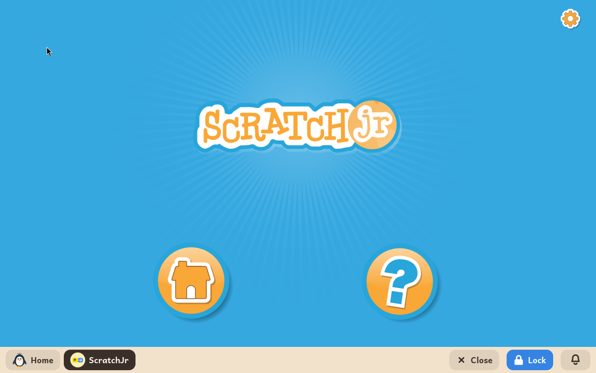

# ScratchJr

*[English version](../../en/modules/scratchjr.md) · [Versión en español](../../es/modules/scratchjr.md)* · [Retour au guide d'utilisation](../user-guide.md#9-modules-dapprentissage)

**ScratchJr** est une plateforme d'initiation à la programmation conçue pour les tout jeunes enfants de 5 à 7 ans. Les enfants peuvent animer des personnages et créer des jeux et des histoires simples en assemblant des blocs illustrés faciles à comprendre, sans avoir besoin de savoir bien lire.

| | |
|---|---|
| **Âge recommandé** | Enfants de 5 à 7 ans (fin de maternelle et début de l'école élémentaire) |
| **Connexion à Internet** | Non nécessaire (fonctionne entièrement hors ligne) |
| **Logiciel utilisé** | [ScratchJr](https://www.scratchjr.org/), développé en collaboration par le MIT Media Lab, l'université Tufts et la Playful Invention Company sous licence BSD-3 |

## Ce que c'est et comment ça marche

Dans ScratchJr, les blocs de code s'emboîtent horizontalement et portent des symboles graphiques clairs plutôt que des mots. L'enfant choisit un animal ou un personnage, fait glisser des blocs de mouvement dans un script, puis touche le drapeau vert pour lancer l'animation.

Les personnages peuvent marcher, sauter, tourner, changer de taille, jouer des sons enregistrés ou réagir quand ils se touchent. L'interface visuelle sans texte permet aux jeunes enfants d'explorer seuls la narration, la pensée séquentielle et la résolution de problèmes.

## Les fonctionnalités

- **Personnages et décors** : une grande bibliothèque de personnages et d'environnements colorés, avec un outil de dessin simple pour créer les siens.
- **Blocs d'action et de contrôle** : mouvement, rotation, bulles de dialogue, pauses et boucles de répétition.
- **Histoires en plusieurs scènes** : plusieurs scènes peuvent s'enchaîner pour former de véritables livres d'histoires.
- **Enregistrement de la voix** : les enfants peuvent enregistrer leur propre voix avec le micro de l'ordinateur pour la donner à leurs personnages.

## Enregistrement des projets

Les projets s'enregistrent automatiquement au fur et à mesure que l'enfant crée, dans `Documents/ScratchJR` dans le dossier personnel de l'enfant. Si le module est un jour désinstallé pour gagner de la place, les créations enregistrées restent intactes et sont disponibles dès la réinstallation.

*Note technique* : ScratchJr fonctionne dans son propre environnement d'exécution autonome (environ 380 Mo) ; l'installation du paquet peut donc prendre quelques minutes selon votre connexion à Internet.
