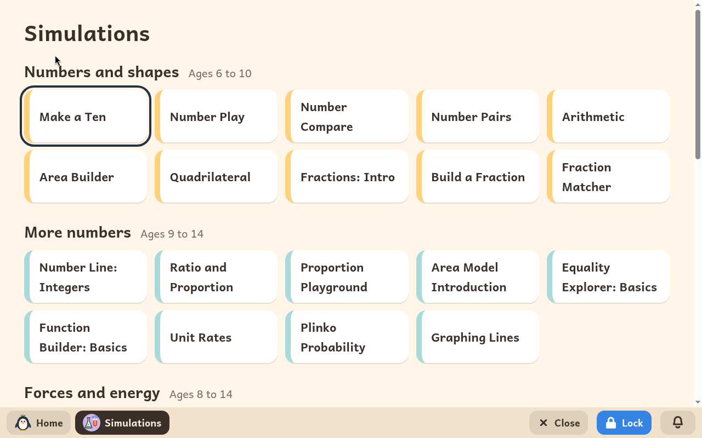
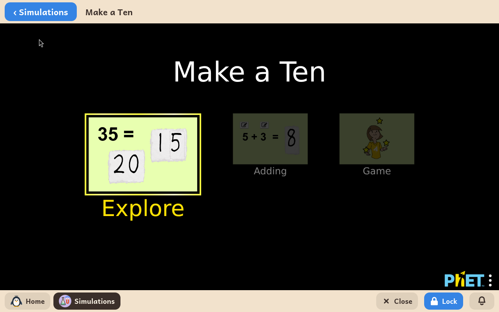

# Simulations

*[English version](../../en/modules/simulations.md) · [Versión en español](../../es/modules/simulations.md)* · [Retour au guide d'utilisation](../user-guide.md#9-modules-dapprentissage)

**Simulations** est une sélection de laboratoires interactifs de mathématiques et de sciences. Elle permet d'explorer des notions scientifiques abstraites par l'expérience visuelle directe : équilibrer une balançoire, dévier un rayon de lumière avec un prisme, produire de l'électricité statique, assembler des atomes et simuler les orbites des planètes.

| | |
|---|---|
| **Âge recommandé** | Enfants et jeunes de 6 à 14 ans |
| **Connexion à Internet** | Non nécessaire (toutes les simulations sont installées sur l'ordinateur) |
| **Logiciel et contenu** | [PhET Interactive Simulations](https://phet.colorado.edu/), créées par l'Université du Colorado à Boulder sous licence Creative Commons Attribution 4.0 (CC BY 4.0). Kidux n'a aucun lien commercial avec PhET. |

## Ce que c'est et comment ça marche

Les simulations PhET sont une ressource éducative reconnue internationalement, utilisée dans les cours de sciences du monde entier. Kidux réunit 51 laboratoires interactifs adaptés aux 6 à 14 ans, classés par discipline et par niveau, présentés entièrement dans la langue préférée de l'enfant.

Chaque simulation s'ouvre dans son propre cadre. Une barre en haut permet de revenir à tout moment à la liste des simulations.

## Ce qu'il y a dedans

**Nombres et formes**, de 6 à 10 ans : Faire un dix, Jeu de nombres, Comparaison de nombres, Paires de nombres, Arithmétique, Constructeur d'aire, Quadrilatère, Fractions : Intro, Construire une fraction, Fractions équivalentes.

**Encore des nombres**, de 9 à 14 ans : Droite des nombres : les entiers, Ratio et proportion, Aire de jeu proportionnelle, Introduction à la modélisation par les aires, Explorateur d'équations : les bases, Constructeur de fonctions : les bases, Taux unitaires, Probabilité avec un plinko, Traceur de droites.

**Forces et énergie**, de 8 à 14 ans : Forces et mouvement : les bases, Équilibrer les masses, Frottements, Énergie au Skate Park : les bases, Formes d'énergie et conversions d'énergie, Masses et ressorts : les bases, Labo du pendule, Mouvement d'un projectile, Lab Force de gravité : notions de base.

**Lumière, son et ondes**, de 8 à 14 ans : Vision des couleurs, Déviation de la lumière, Optique géométrique : les bases, Introduction aux ondes, Onde sur une corde.

**Électricité et aimants**, de 8 à 14 ans : Ballons et électricité statique, John Travolt ... aahh, Aimant et boussole, Aimants et électro-aimants, Construire un circuit : CC.

**La matière et les atomes**, de 9 à 14 ans : États de la matière : les bases, Introduction aux gaz, Masse volumique, Poussée d'Archimède, Construire un atome, Créer une molécule, Concentration, Échelle de pH : les bases.

**La Terre, l'espace et le vivant**, de 8 à 14 ans : Gravité et orbites, Mon système solaire, Effet de serre, Sous pression, Sélection naturelle.

## À savoir

- **Crédits et licence** : chaque simulation porte, sous sa zone de jeu, l'attribution à PhET Interactive Simulations (Université du Colorado à Boulder), comme l'exige la licence CC BY 4.0.
- **Stockage** : les simulations tournent dans la mémoire du navigateur et ne laissent aucun fichier temporaire dans le dossier de documents de l'enfant.
