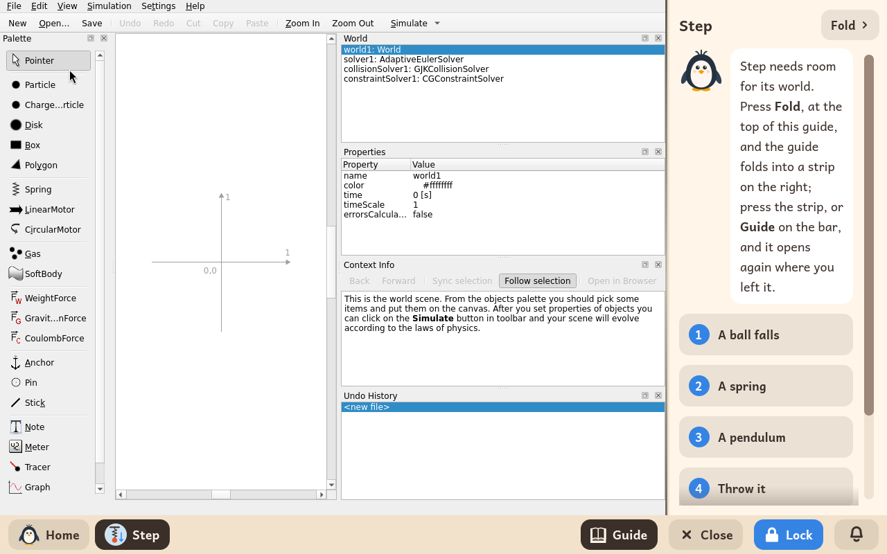

# Step

*[English version](../../en/modules/step.md) · [Versión en español](../../es/modules/step.md)* · [Retour au guide d'utilisation](../user-guide.md#9-modules-dapprentissage)

**Step** est un simulateur physique interactif en deux dimensions développé par le projet KDE Éducation. Il permet de construire des expériences de mécanique virtuelles sur un plan, en y plaçant des corps, des ressorts, des cordes et des forces, pour simuler en temps réel les lois du mouvement, les collisions et la conservation de l'énergie.

| | |
|---|---|
| **Âge recommandé** | Élèves de 10 à 16 ans |
| **Recommandé avant** | Simulations |
| **Connexion à Internet** | Non nécessaire (fonctionne entièrement hors ligne) |
| **Logiciel utilisé** | [Step](https://apps.kde.org/step/), développé par la communauté KDE sous licence GPL-2, empaqueté depuis Debian |

## Ce que c'est et comment ça marche

Step propose une large palette d'objets mécaniques : particules ponctuelles, disques, corps rectangulaires rigides, ressorts, moteurs, champs de force, attraction gravitationnelle, ancrages fixes et capteurs virtuels.

L'élève place des corps dans le monde, indique leurs propriétés physiques (comme la masse, la vitesse initiale, le frottement ou la raideur d'un ressort) dans l'inspecteur de propriétés, et lance la simulation. Le moteur de simulation résout numériquement les équations du mouvement en temps réel, en traçant les trajectoires et des graphiques dynamiques. Le menu **Fichier > Exemples** propose un grand choix d'expériences classiques de physique prêtes à lancer.

## Le guide interactif intégré

Kidux accompagne Step d'un guide interactif placé à côté, avec six leçons structurées. Cinq d'entre elles comportent une **mission de laboratoire** : un fichier de projet préparé, avec des défis interactifs, copié automatiquement dans le dossier `Documents/Missions de Step` de l'élève la première fois que le guide est ouvert :

1. **Une balle tombe** : l'accélération due à la pesanteur et le graphique d'une chute libre. Mission : `chute.step`.
2. **Un ressort** : des oscillateurs harmoniques à deux masses, et ce qui change avec la raideur du ressort. Mission : `ressort.step`.
3. **Un pendule** : des tiges rigides avec des masses, et l'isochronisme des petites oscillations. Mission : `pendule.step`.
4. **Lance-la** : les trajectoires de projectiles en deux dimensions et les courbes d'un lancer horizontal. Mission : `lancer.step`.
5. **Mesure-le** : régler des instruments de mesure, des vecteurs vitesse et des graphiques en temps réel.
6. **Rebonds et chocs** : les collisions élastiques et inélastiques, et la conservation de la quantité de mouvement. Mission : `rebond.step`.

Pour laisser un maximum de place au plan de l'expérience, le bouton **Replier**, en haut, replie le guide ; cliquer sur **Guide** dans la barre du bas le rouvre exactement là où l'élève s'était arrêté.

## Enregistrer les fichiers et les missions

Les expériences créées peuvent être enregistrées au format `.step` avec **Fichier > Enregistrer**, dans le dossier de documents personnel de l'élève. Les missions de laboratoire s'ouvrent avec **Fichier > Ouvrir > Documents > Missions de Step**.

## À savoir

- **Environnement isolé** : le téléchargement d'expériences de la communauté en ligne et les liens vers l'aide sur le Web sont désactivés, pour garder un environnement isolé et sans distractions.
- **Liens externes** : cliquer sur une référence web dans le panneau d'informations affiche un message indiquant que l'accès à Internet est désactivé.
