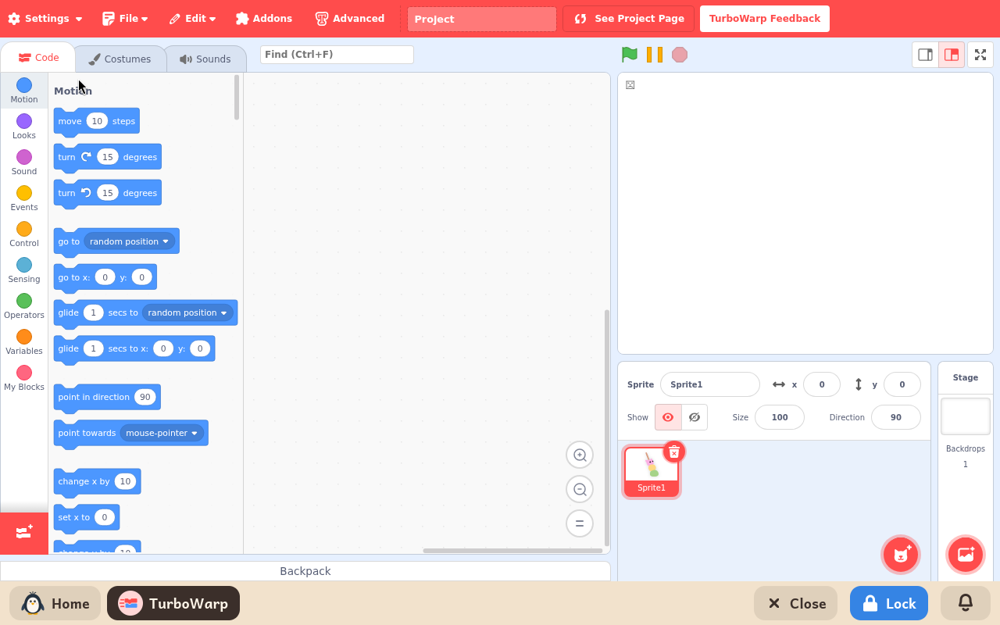

# TurboWarp

*[English version](../../en/modules/turbowarp.md) · [Versión en español](../../es/modules/turbowarp.md)* · [Retour au guide d'utilisation](../user-guide.md#9-modules-dapprentissage)

**TurboWarp** est une alternative plus performante à Scratch, avec un compilateur JavaScript optimisé à la volée. Il a exactement la même interface de blocs et les mêmes formats de projet que Scratch, mais fait tourner les jeux, les scripts et les animations avec beaucoup plus d'images par seconde.

| | |
|---|---|
| **Âge recommandé** | Enfants et jeunes de 8 à 16 ans |
| **Recommandé avant** | ScratchJr |
| **Connexion à Internet** | Facultative (nécessaire seulement pour télécharger des lutins, des arrière-plans et des sons depuis la bibliothèque officielle ; programmer et lancer les projets fonctionne entièrement hors ligne) |
| **Logiciel utilisé** | [TurboWarp](https://turbowarp.org/), développé par le projet libre TurboWarp sous licence GPL-3, empaqueté pour fonctionner hors ligne dans Kidux |

## Ce que c'est et comment ça marche

TurboWarp est le choix idéal pour les ordinateurs anciens, les portables peu puissants ou les projets complexes pour lesquels Scratch saccade ou ralentit. Les enfants habitués à Scratch retrouvent les outils, les palettes et les catégories de blocs exactement à leur place habituelle.

En plus de sa vitesse d'exécution, TurboWarp propose des options de personnalisation pratiques, comme un mouvement fluide à 60 images par seconde, des tailles de scène personnalisées et des options de débogage pour les développeurs.

## Les fonctionnalités

- **Une interface familière** : la même disposition que Scratch, avec tous les blocs habituels, les costumes et les sons.
- **La bibliothèque officielle** : téléchargement facultatif, à la demande, des lutins, effets sonores et arrière-plans officiels de Scratch.
- **Des performances de projet compilé** : une exécution parfaitement fluide grâce à un compilateur interne à la volée.
- **Des options avancées** : nombre d'images par seconde, interpolation et taille de la scène réglables.

## Enregistrement des projets et compatibilité

La gestion des projets est la même que dans Scratch : cliquez sur **Fichier > Sauvegarder sur votre ordinateur** pour enregistrer les projets au format standard `.sb3` dans le dossier de documents de l'enfant. Pour reprendre un projet, utilisez **Fichier > Charger depuis votre ordinateur**.

Les projets sont entièrement interchangeables : tout fichier `.sb3` enregistré dans Scratch s'ouvre sans problème dans TurboWarp, et inversement. Pour la sécurité des enfants en ligne, le téléchargement de projets publics de la communauté Scratch par leur numéro est désactivé ; tout le travail est ouvert et enregistré sous forme de fichiers de projet locaux.
