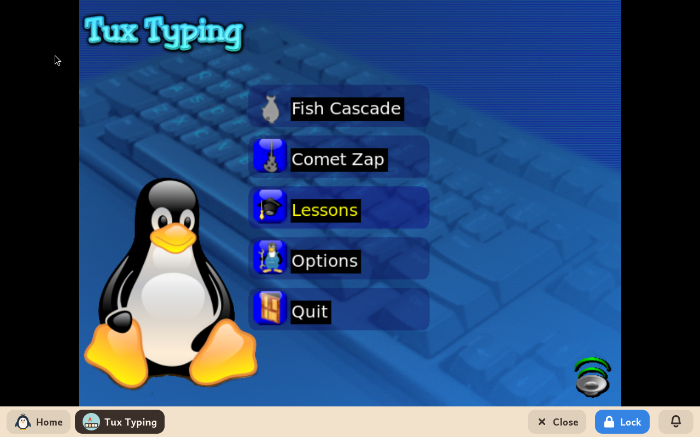
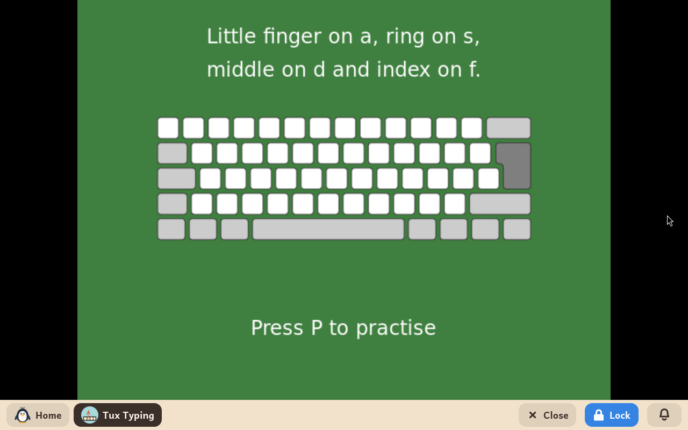
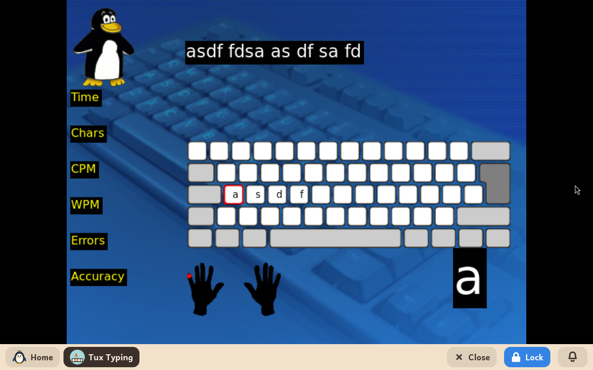

# Tux Typing

*[English version](../../en/modules/tuxtype.md) · [Versión en español](../../es/modules/tuxtype.md)* · [Retour au guide d'utilisation](../user-guide.md#9-modules-dapprentissage)

**Tux Typing** est un jeu éducatif de dactylographie de style arcade, avec Tux, le pingouin de Linux. Il aide les enfants à maîtriser la disposition du clavier, à taper plus vite et à acquérir des automatismes grâce à des défis d'arcade ludiques.

| | |
|---|---|
| **Âge recommandé** | Enfants de 6 à 12 ans |
| **Recommandé avant** | GCompris (pour se familiariser d'abord avec les lettres et les touches du clavier) |
| **Connexion à Internet** | Non nécessaire (fonctionne entièrement hors ligne) |
| **Logiciel utilisé** | [Tux Typing](https://github.com/tux4kids/tuxtype), développé par la communauté Tux4Kids sous licence GPL, tel que Debian le compile, avec de petites modifications de Kidux pour les claviers autres que le clavier américain |

## Ce que c'est et comment ça marche

Dans les jeux d'arcade de Tux Typing, des lettres ou des mots entiers tombent du ciel. L'enfant doit taper chaque lettre avant qu'elle ne touche le sol, pour que Tux mange le poisson qui tombe ou fasse exploser les astéroïdes qui arrivent. Au fil des niveaux, la vitesse de chute augmente et les mots s'allongent.

L'interface et les listes de mots du jeu sont traduites dans la langue choisie pour l'enfant, si bien que les enfants s'entraînent à taper des mots de leur propre langue. En français, les mots sont des listes propres à Kidux, correctement orthographiées, avec leurs accents.

## Les modes de jeu

- **Cascade de poissons** : des lettres seules qui tombent ; idéal pour apprendre la position des touches sur tout le clavier.
- **Destruction de comètes** : des mots qui tombent et qu'il faut taper sans faute avant l'impact.
- **Leçons** : le cours de dactylographie de Kidux, décrit plus bas.

Avant de jouer, l'enfant choisit une liste de mots. En français, il y en a sept propres à Kidux : **Mots courts**, **Les animaux**, **La nourriture**, **La maison**, **La nature**, **Avec é, è et à** et **Avec ç, ù et ^**. Ce sont tous des mots qu'un enfant connaît. Les accents apparaissent dans toutes les listes qui en ont besoin, et sont rassemblés dans les deux dernières, comme dans le cours, où ils arrivent à la fin.

## Les leçons de dactylographie

Kidux apporte son propre cours, dans la langue de l'enfant, qui apprend à taper à l'aveugle avec les dix doigts dans l'ordre classique. En français, il est fait pour le clavier AZERTY et compte quinze leçons : la rangée de repos d'abord (q s d f et j k l m), puis la rangée du haut et enfin celle du bas, avec la virgule et le point ; les trois dernières apprennent é et è, puis à, ç et ù, et enfin l'accent circonflexe, qui se tape avant la voyelle. La rangée de repos de l'AZERTY n'a pas de voyelle : dans les deux premières leçons, le second exercice mélange donc les touches apprises au lieu de former des mots.

- **Choisir une leçon** : dans le menu principal, **Leçons** affiche la liste, de « Leçon 01 - q s d f » à « Leçon 15 - accent circonflexe », huit par page ; la flèche du bas passe à la page suivante. Une leçon se choisit à la souris, ou avec les flèches et Entrée.
- **Les étapes de chaque leçon** : une première page présente les nouvelles touches (**Entrée** pour continuer) ; la deuxième montre quel doigt tape chacune d'elles sur un clavier dessiné ; **P** lance l'exercice sur ces touches puis, une fois celui-ci terminé, un second exercice avec des mots faits uniquement de lettres déjà apprises. À la fin, **Entrée** ramène au menu principal.
- **Pendant l'exercice** : la ligne à taper est en haut. En dessous se trouve un clavier sur lequel seules les touches de cet exercice sont écrites, pour que l'enfant les trouve tout de suite, avec un cadre rouge sur la suivante. Plus bas, cette touche est affichée en grand et, sur les mains dessinées, un point rouge clignote sur le doigt qui la tape. À la fin, Tux fête la réussite avec le temps, les erreurs et la précision.
- **Sortir** : **Échap** met l'exercice en pause à tout moment ; une seconde pression le quitte.

## À savoir

- **Meilleurs scores et progression** : la progression, les meilleurs scores et les niveaux débloqués sont enregistrés à l'intérieur de l'application, sans encombrer le dossier de documents de l'enfant.
- **Ce que le cours ne couvre pas encore** : les majuscules.
- **Statistiques en anglais** : les chiffres de l'exercice (Time, Chars, CPM, WPM, Errors, Accuracy) s'affichent en anglais, car Tux Typing lui-même ne les a pas traduits : ce sont le temps, les caractères, les frappes et les mots par minute, les erreurs et la précision.
- **Résolution de l'écran** : comme il s'agit d'une ancienne application graphique, choisir une taille d'affichage mise à l'échelle (signalée par un astérisque `*` dans la page Système de l'espace adulte) peut rendre l'image légèrement floue. Choisir une taille sans mise à l'échelle rend un affichage net.
