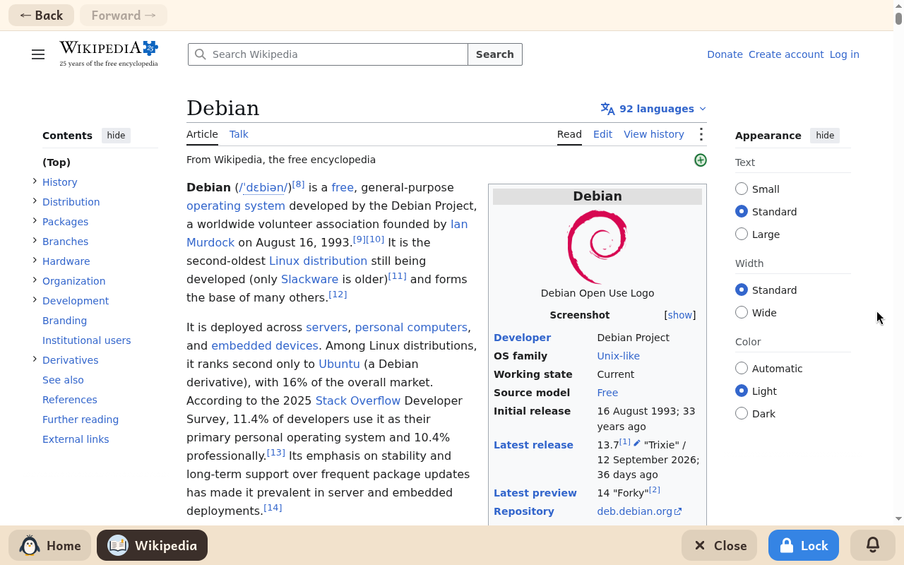

# Wikipédia

*[English version](../../en/modules/wikipedia.md) · [Versión en español](../../es/modules/wikipedia.md)* · [Retour au guide d'utilisation](../user-guide.md#9-modules-dapprentissage)

**Wikipédia** donne un accès filtré et sûr à la grande encyclopédie libre et à ses projets éducatifs frères (comme le Wiktionnaire et Wikilivres), dans la langue choisie pour l'enfant.

| | |
|---|---|
| **Âge recommandé** | À partir de 8 ans (à l'appréciation de l'adulte, puisque Wikipédia est une encyclopédie générale ouverte) |
| **Connexion à Internet** | Nécessaire en permanence pour charger les articles et les médias |
| **Service web** | [wikipedia.org](https://www.wikipedia.org/), géré par la Wikimedia Foundation et des contributeurs bénévoles |

## Ce que c'est et comment ça marche

Ce module ouvre une fenêtre de navigateur isolée, limitée strictement à Wikipédia et aux domaines éducatifs frères (comme le Wiktionnaire, Wikidata, Wikimedia Commons et Wikilivres). Pour protéger les jeunes lecteurs, tous les liens vers l'extérieur, les sources externes citées en référence et les réseaux sociaux sont bloqués.

Le contenu est l'encyclopédie Wikipédia complète et authentique. Les enfants peuvent chercher des sujets, lire des articles riches en illustrations et en schémas, et suivre les liens entre notions voisines sans aucune difficulté.

## La navigation

Une fine barre en haut donne les commandes essentielles :
- **Précédent** et **Suivant** : passer d'un article visité à l'autre dans l'historique (les boutons sont grisés quand il n'y a plus d'historique).
- **Raccourcis clavier et souris** : le raccourci habituel **Alt + Flèche gauche** et le bouton « précédent » sur le côté des souris fonctionnent normalement.

## À savoir

- **Enregistrement** : lire des articles ne crée aucun fichier dans le dossier de documents de l'enfant.
- **Supervision d'un adulte** : comme Wikipédia est une encyclopédie générale ouverte qui couvre un très large champ de connaissances, les adultes choisissent pour quels enfants activer le module, selon leur maturité et leurs besoins scolaires.
