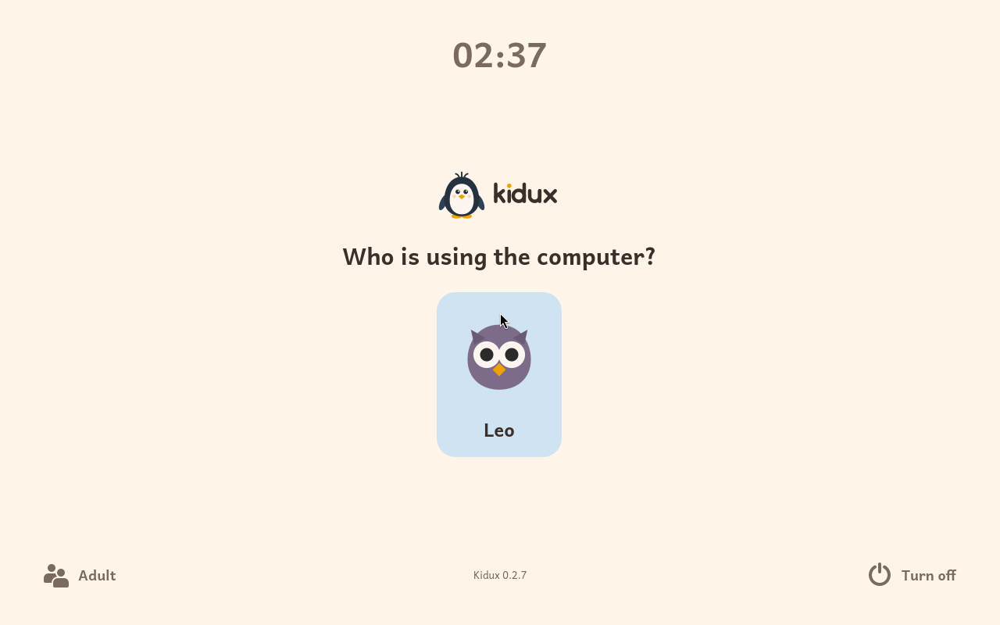
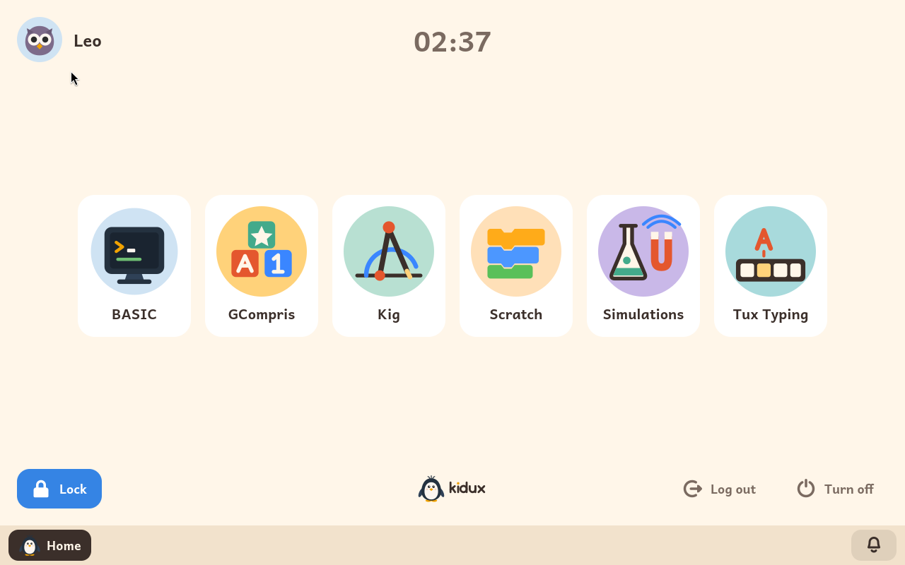

# Essayer Kidux dans un émulateur

*[English version](../en/try.md) · [Versión en español](../es/try.md)*

**Kidux peut s'essayer sur l'ordinateur que vous utilisez tous les jours, avant de lui confier un ordinateur à lui.** Cela se fait avec un émulateur : un programme qui fait tourner un ordinateur complet dans une fenêtre. L'émulateur démarre Kidux à partir d'une image préparée spécialement pour cet essai, avec une famille déjà dedans, un enfant et plusieurs modules d'apprentissage activés pour lui. Rien n'est installé sur votre ordinateur à part l'émulateur lui-même, et quand vous fermez la fenêtre, tout est laissé exactement comme c'était.

Ce que vous voyez dans la fenêtre, c'est Kidux en entier, pas une démonstration allégée. C'est le même système que celui que l'installateur met sur un ordinateur, avec son écran de connexion, l'écran de l'enfant, les limites de temps, l'écran de verrouillage et l'espace adulte. Il se met même à jour depuis le dépôt de paquets de Kidux, comme le ferait n'importe quel ordinateur où Kidux est installé.

Mieux vaut savoir d'avance qu'un émulateur ne tourne jamais aussi vite qu'un vrai ordinateur. Kidux tourne à l'intérieur d'un autre système, qui doit partager avec lui son processeur et sa mémoire ; tout répond donc un peu plus lentement que sur un ordinateur où Kidux est installé. Sur un Mac avec un processeur Apple, la différence est plus grande : Kidux est fait pour les processeurs de PC, et le Mac doit en imiter un en entier, instruction par instruction. Sur ces Mac, l'émulateur demande donc plus de ressources, surtout plus de cœurs de processeur ; les étapes d'UTM ci-dessous disent combien. Rien de tout cela ne change la façon dont Kidux fonctionne une fois installé sur un ordinateur à lui.

## La famille de l'image d'essai

L'image arrive préparée avec ces informations, pour que vous puissiez commencer à l'essayer dès qu'elle a démarré :

| | |
|---|---|
| **L'enfant** | S'appelle **Leo**, et son mot de passe est `leo`. |
| **Le mot de passe adulte** | Est `kidux`. Il ouvre l'espace adulte depuis l'écran de connexion ou depuis l'écran de verrouillage. |
| **L'administrateur** | Est le compte `anna`, avec le mot de passe `kidux`. Il sert pour la console texte, dont un essai normal n'a jamais besoin. |
| **Modules d'apprentissage** | Leo a six modules installés et activés : BASIC, Tux Typing, Scratch, GCompris, Simulations et Kig. Les autres peuvent être installés depuis l'espace adulte. |
| **Temps** | Leo n'a aucune limite de temps, pour que vous puissiez essayer tranquillement. Si vous voulez voir comment fonctionnent les limites, l'espace adulte permet d'en fixer une. |
| **Langues** | Il y a deux images : une en espagnol et une en anglais. Pour essayer Kidux en français, prenez l'image anglaise, puis, dans l'espace adulte, choisissez Français comme langue de l'ordinateur dans la page **Système**, et comme langue de Leo dans la page **Enfants**. |
| **Ce qu'il faut** | Environ 4 Go de mémoire libres pour l'émulateur, et environ 10 Go d'espace disque. Sur un Mac avec un processeur Apple, il faut aussi plusieurs cœurs de processeur pour l'émulateur : quatre ou plus. |

Une fois démarré, Kidux affiche son écran de connexion avec l'image de Leo. Une fois le mot de passe de Leo tapé, son écran apparaît avec les six modules :





## Quelle image télécharger, selon votre ordinateur

Il existe deux formats d'image, parce que chaque émulateur préfère le sien. Le fichier `.ova` est pour VirtualBox, et le fichier `.qcow2` pour UTM et pour QEMU. Ce tableau indique quel émulateur et quelle image conviennent à chaque cas :

| Votre ordinateur | L'émulateur | L'image |
|---|---|---|
| **Windows** | [VirtualBox](https://www.virtualbox.org/), gratuit | [kidux-trial-en.ova](https://iso.kidux.org/kidux-trial-en.ova) |
| **Mac avec un processeur Intel** | VirtualBox, ou bien [UTM](https://mac.getutm.app/) | Le `.ova` pour VirtualBox, ou le `.qcow2` pour UTM |
| **Mac avec un processeur Apple** (M1 et suivants) | [UTM](https://mac.getutm.app/), gratuit | [kidux-trial-en.qcow2](https://iso.kidux.org/kidux-trial-en.qcow2) |
| **Linux** | QEMU, ou bien VirtualBox | Le `.qcow2` pour QEMU, ou le `.ova` pour VirtualBox |

Les images espagnoles s'appellent `kidux-trial-es.ova` et `kidux-trial-es.qcow2`, et se trouvent à la même adresse. Chaque fichier fait environ 1,5 Go.

Si vous voulez vérifier que le téléchargement est arrivé entier, les sommes SHA-256 de toutes les images sont dans [SHA256SUMS](https://iso.kidux.org/SHA256SUMS). Gardez un détail à l'esprit : le nom complet de chaque fichier comprend la version de Kidux, et c'est ce nom complet qui figure dans la liste des sommes et sous lequel un navigateur enregistre le fichier. Si votre programme de téléchargement l'a plutôt enregistré sous le nom court du lien, cherchez dans la liste la ligne de sa langue et de son format, et comparez la somme à la main.

## Windows, ou un Mac ou Linux, avec VirtualBox

1. **Installez VirtualBox et téléchargez l'image `.ova`.** VirtualBox se télécharge gratuitement sur son site, et s'installe comme n'importe quel autre programme.

2. **Importez l'image.** Dans VirtualBox, choisissez le menu **Fichier > Importer un appareil virtuel**, sélectionnez le fichier `.ova` téléchargé et appuyez sur **Terminer**. VirtualBox crée une machine déjà configurée : deux processeurs, 4 Go de mémoire et un démarrage UEFI, comme celui de n'importe quel ordinateur acheté ces dix dernières années. Aucun réglage n'est à changer.

3. **Démarrez la machine.** Sélectionnez-la dans la liste et appuyez sur **Démarrer**. Le logo de Kidux apparaît et, peu après, son écran de connexion avec Leo.

Pour voir les écrans de Kidux en entier, la fenêtre doit faire au moins 1280 sur 800 points. Vous pouvez aussi utiliser le menu **Écran > Mode plein écran**.

## Un Mac avec UTM

Les menus d'UTM sont donnés ici en anglais, avec leur sens entre parenthèses.

1. **Installez UTM et téléchargez l'image `.qcow2`.** UTM se télécharge gratuitement sur son site.

2. **Créez une nouvelle machine.** Dans UTM, appuyez sur **Create a New Virtual Machine** (Créer une nouvelle machine virtuelle). Choisissez ensuite **Emulate** (Émuler), puis **Other** (Autre).

3. **Choisissez le matériel.** Sur l'écran **Hardware** (Matériel), laissez la machine **Intel ICH9 based PC (2009, x86_64)** choisie et la mémoire à **4096 MiB**. Dans **CPU Cores** (Cœurs de processeur), tapez **4** ; si votre Mac a plus de 8 cœurs, tapez la moitié de ce qu'il a. Appuyez sur **Continue** (Continuer).

4. **Laissez la machine sans disque de démarrage.** Sur l'écran suivant, sous **Boot Device** (Périphérique de démarrage), choisissez **None** (Aucun). Laissez la case **UEFI Boot** cochée, comme elle l'est déjà, et appuyez sur **Continue**.

5. **Terminez l'assistant.** Sur **Storage** (Stockage), appuyez sur **Continue** sans rien changer : le disque proposé est remplacé à l'étape suivante. Sur **Shared Directory** (Dossier partagé), appuyez sur **Continue** sans rien choisir. Sur **Summary** (Résumé), nommez-la *Kidux*, cochez la case **Open VM Settings** (Ouvrir les réglages de la machine) et appuyez sur **Save** (Enregistrer).

6. **Remplacez le disque par l'image de Kidux.** Dans la fenêtre de réglages qui s'ouvre, descendez dans la colonne de gauche jusqu'à la section **Drives** (Disques). Sélectionnez **IDE Drive**, appuyez sur **Delete** (Supprimer) et confirmez que vous voulez le retirer. Appuyez ensuite sur **New...** (Nouveau), changez **Interface** en **VirtIO**, appuyez sur **Import...** (Importer) et choisissez le fichier `.qcow2` téléchargé. Pour finir, appuyez sur **Save**.

7. **Démarrez la machine.** Appuyez sur le triangle à côté de son nom. Le logo d'UTM apparaît d'abord, puis celui de Kidux et, en moins d'une minute, son écran de connexion avec Leo. Il est normal que l'écran reste noir quelques secondes entre les deux : attendez simplement.

En important l'image, UTM en fait sa propre copie, qui occupe environ 3,5 Go. Une fois l'image importée, le fichier téléchargé peut donc être supprimé sans risque.

Gardez à l'esprit que Kidux est fait pour les ordinateurs PC. Sur un Mac avec un processeur Apple, UTM doit émuler un processeur de PC complet : tout fonctionne, mais plus lentement que sur un vrai ordinateur. Plus vous donnez de cœurs à la machine, mieux elle tourne : avec 2 cœurs, c'est très lent ; avec 4, c'est utilisable ; et avec 8, cela tourne assez bien. Sur un Mac avec un processeur Intel, il n'y a rien à émuler, et UTM comme VirtualBox font tourner Kidux à pleine vitesse.

## Linux avec QEMU

Installez QEMU et son micrologiciel UEFI. Sous Debian ou Ubuntu, ce sont les paquets `qemu-system-x86` et `ovmf`. Téléchargez ensuite l'image `.qcow2` et, depuis le dossier où elle se trouve, démarrez-la avec cette commande :

```
qemu-system-x86_64 -enable-kvm -cpu host -m 4096 -smp 2 -machine q35 \
    -bios /usr/share/ovmf/OVMF.fd \
    -drive file=kidux-trial-en.qcow2,if=virtio \
    -vga none -device VGA,xres=1280,yres=800 \
    -device qemu-xhci -device usb-tablet -nic user,model=virtio-net-pci
```

Le logo de Kidux apparaît, puis son écran de connexion avec Leo. Tout ce que vous changez pendant l'essai est gardé dans le fichier image lui-même. Si vous voulez recommencer depuis le début, il suffit de télécharger l'image à nouveau.

## Ce qu'un essai ne peut pas montrer

Un émulateur montre presque tout ce que fait Kidux, mais quelques choses ne se voient que sur un vrai ordinateur :

- **Les composants propres au vrai ordinateur.** Son Wi-Fi, son capot, sa batterie ou ses touches de luminosité et de volume. Dans un émulateur, Kidux voit le réseau de l'émulateur comme s'il s'agissait d'un câble, et ne trouve ni batterie ni capot.
- **La vitesse d'un vrai ordinateur.** Un émulateur est toujours plus lent que le même ordinateur avec Kidux installé, et beaucoup plus lent quand il doit aussi émuler un autre processeur.
- **Les touches que l'ordinateur garde pour lui.** Certaines combinaisons, comme Ctrl+Alt+Suppr, sont reçues par l'ordinateur qui fait tourner l'émulateur, et n'arrivent jamais à Kidux.

Quand vous en avez assez vu, [le guide d'utilisation](user-guide.md#2-installer-kidux) explique comment installer Kidux sur un ordinateur à lui.
