# Guide d'utilisation de Kidux

*[English version](../en/user-guide.md) · [Versión en español](../es/user-guide.md)*

Ce guide s'adresse à l'adulte qui s'occupe d'un ordinateur Kidux. Les
enfants n'ont pas besoin de guide : chaque écran auquel ils ont accès
s'explique de lui-même.

## 1. Ce qu'il faut

- Un ordinateur avec un **processeur 64 bits**. Presque tous les PC de
  bureau et portables fabriqués depuis 2008 en ont un.
- Au moins **2 Go de mémoire vive**. 4 Go, c'est mieux.
- **32 Go de disque**, et le disque entier. Kidux garde le système sur une
  partie du disque et le travail des enfants sur une autre. Ainsi, le
  système peut être mis à jour, ou même réinstallé, sans toucher à rien de
  ce que les enfants ont fait.
- Un écran d'au moins **1280 sur 800** pixels, affiché à 100 %. Chaque
  écran de Kidux est fait pour tenir en entier à cette taille. Mieux vaut
  un écran qui a plus de place : **1920 sur 1080** à 100 %, ou un écran
  haute densité affiché plus grand, comme 2560 sur 1600 à 150 % ou les
  2880 sur 1800 d'un MacBook à 175 %, la taille que Kidux choisit de
  lui-même pour lui ; chacun laisse environ 1650 sur 1030 de place, ou
  plus. Les modules d'apprentissage qui ont des panneaux sur les côtés,
  comme Step, Kig et Scratch, et ceux qui ont un guide à côté, fonctionnent
  en 1280 sur 800 mais y sont à l'étroit ; avec cette place-là, ils sont
  confortables. Sur un écran plus petit que 1280 sur 800, comme 1366 sur
  768 ou 1024 sur 768, certains écrans de Kidux défilent, et certains
  modules d'apprentissage peuvent avoir des parties cachées ou mal
  fonctionner. La taille à laquelle tout est affiché se choisit dans
  l'espace adulte (section 8).

## 2. Installer Kidux

Il y a deux façons de mettre Kidux sur un ordinateur, et une troisième
possibilité pour le voir fonctionner avant même de lui confier un
ordinateur. Ce tableau résume laquelle convient à chaque cas :

| Ce que vous voulez | Ce qu'il faut faire |
|---|---|
| **Installer Kidux sur un ordinateur** | **Télécharger l'installateur**, le copier sur une clé USB et démarrer l'ordinateur dessus. C'est la façon habituelle et la plus rapide, expliquée juste après, dans [Avec l'image de Kidux](#avec-limage-de-kidux). |
| **Essayer Kidux d'abord**, sur l'ordinateur que vous utilisez tous les jours | Télécharger une image préparée pour un émulateur, sous Windows, macOS ou Linux, avec une famille déjà dedans. Rien n'est installé sur l'ordinateur lui-même. La page [Essayer Kidux dans un émulateur](try.md) explique comment faire. |
| **L'installer sur une Debian** que vous préparez vous-même | C'est expliqué plus bas, dans [Sur Debian](#sur-debian). Le résultat est exactement le même Kidux, mais cela prend environ une heure. |

### Avec l'image de Kidux

L'installateur de Kidux est l'image d'une clé USB : un seul fichier,
d'environ 750 Mo, avec tout ce dont Kidux a besoin. Vous le copiez sur une
clé, vous démarrez l'ordinateur dessus et, en quelques minutes, Kidux est
installé sur tout le disque de l'ordinateur. Il n'a besoin d'aucune
connexion réseau pendant l'installation.

Gardez à l'esprit que tout ce qui se trouve sur le disque de l'ordinateur
est effacé. S'il y a quelque chose que vous voulez garder, copiez-le
ailleurs avant.

1. **Téléchargez l'installateur.** Sur un autre ordinateur, téléchargez le
   fichier [kidux-amd64.iso](https://iso.kidux.org/kidux-amd64.iso). Le nom
   complet du fichier indique la version de Kidux qu'il installe. Si vous
   voulez vérifier que le téléchargement est arrivé entier, sa somme
   SHA-256 se trouve dans [SHA256SUMS](https://iso.kidux.org/SHA256SUMS),
   et la signature de cette liste, faite avec la clé de Kidux, dans
   [SHA256SUMS.sign](https://iso.kidux.org/SHA256SUMS.sign).

2. **Copiez-le sur une clé USB** de 2 Go ou plus. Vous pouvez utiliser un
   programme comme [balenaEtcher](https://etcher.balena.io/) : choisissez
   le fichier, choisissez la clé et lancez l'écriture. Tout ce qui se
   trouvait sur la clé est effacé. Une carte SD, ou tout autre support
   externe sur lequel l'ordinateur peut démarrer, fonctionne exactement de
   la même façon.

3. **Démarrez l'ordinateur sur la clé.** Branchez la clé, allumez
   l'ordinateur et ouvrez son menu de démarrage. En général, il faut pour
   cela appuyer sur F12, F11, F8, Échap ou F2 juste après l'avoir allumé ;
   sur un Mac, maintenir la touche Option enfoncée. Dans ce menu,
   choisissez la clé. Si l'ordinateur a le **Secure Boot** activé, inutile
   de le désactiver : la clé démarre telle quelle.

4. **Choisissez la langue.** Le menu de Kidux propose deux options :
   **Instalar Kidux**, en espagnol, et **Install Kidux**, en anglais.
   Choisissez **Install Kidux** : l'installateur sera en anglais, mais
   c'est au premier démarrage que Kidux demande sa propre langue, et le
   français y est proposé. Si vous ne choisissez rien, la première option
   démarre d'elle-même au bout de dix secondes. Si l'écran reste noir ou
   brouillé, redémarrez l'ordinateur et choisissez **Gráficos seguros /
   Safe graphics**, qui propose les deux mêmes options avec un affichage
   plus simple.

   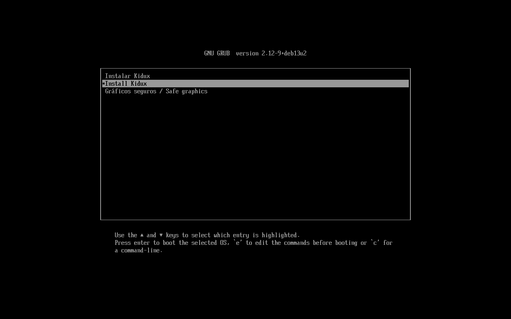

5. **Répondez à l'installateur.** Ses étapes sont listées dans la colonne
   de gauche, et le bouton **Next** (Suivant) passe de l'une à l'autre.
   Voici ce que demande chaque étape :

   | Étape | Ce qu'elle demande |
   |---|---|
   | **Welcome** (Bienvenue) | Rien. Elle vérifie que l'ordinateur a assez de disque et de mémoire. |
   | **Location** (Emplacement) | Le fuseau horaire. Il se choisit sur la carte. |
   | **Keyboard** (Clavier) | La disposition du clavier, qu'on peut essayer dans la case en dessous. Ne vous inquiétez pas si vous hésitez : Kidux redemande sa propre langue et son clavier à son premier démarrage. |
   | **Partitions** | Rien à choisir. L'installateur efface tout le disque et le découpe comme Kidux en a besoin : le système sur une partie et le travail des enfants sur une autre. La page montre le disque avant et après. |
   | **Users** (Utilisateurs) | Un compte pour vous, l'adulte qui s'occupe de l'ordinateur. Elle demande votre nom, un nom d'utilisateur, le nom de l'ordinateur (`kidux` est déjà écrit) et un mot de passe, deux fois. Les enfants auront leurs propres comptes dans Kidux. Ce mot de passe n'est pas non plus celui qui ouvre l'espace adulte, qui se choisit au premier démarrage. Laissez **Log in automatically** (Se connecter automatiquement) décoché : Kidux démarre toujours sur son propre écran de connexion. |
   | **Summary** (Résumé) | Montre ce qui va se passer. Le bouton **Install** (Installer) lance l'installation, après une dernière question de confirmation. |
   | **Install** (Installation) | Une barre montre l'avancement. Cela prend quelques minutes. |
   | **Finish** (Fin) | Kidux est maintenant installé. Avec la case **Restart now** (Redémarrer maintenant) cochée, le bouton **Done** (Terminé) redémarre l'ordinateur. |

   La première page de l'installateur :

   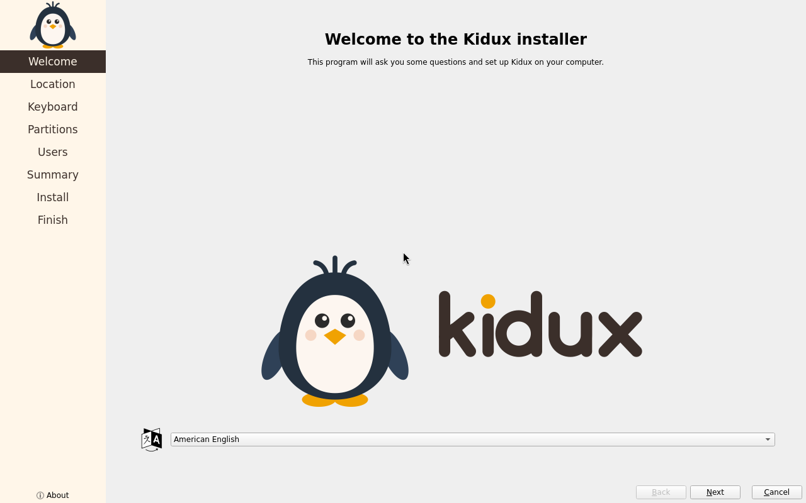

   Le disque, découpé comme Kidux en a besoin :

   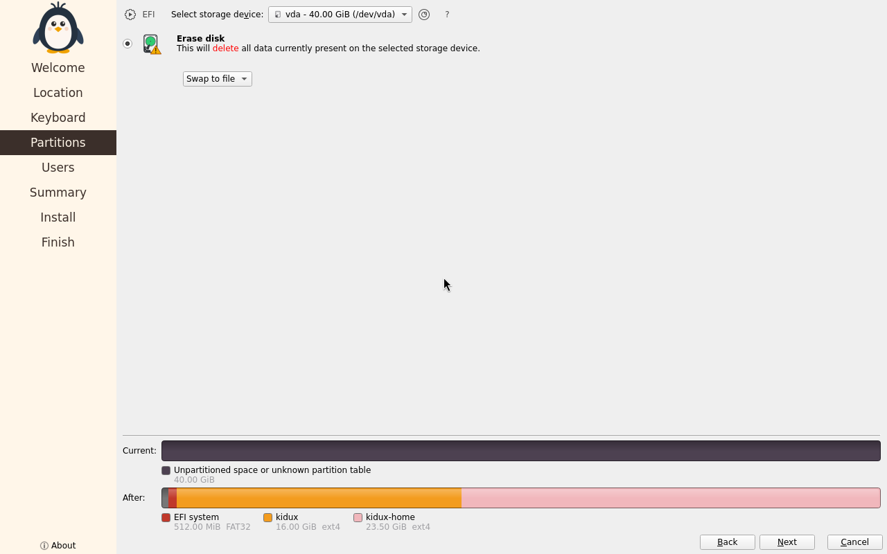

   Votre compte, celui de l'adulte :

   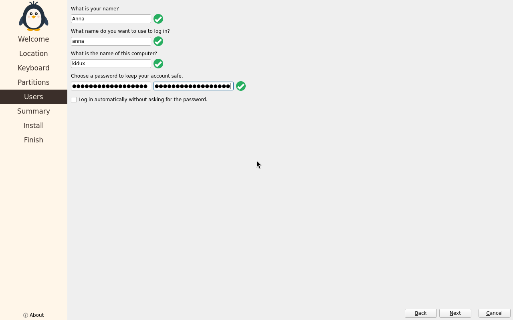

   Ce qui va se passer :

   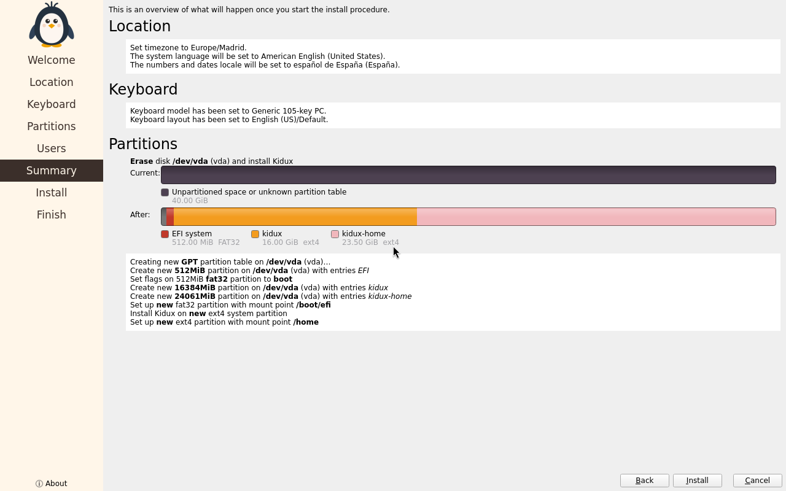

   Et la fin :

   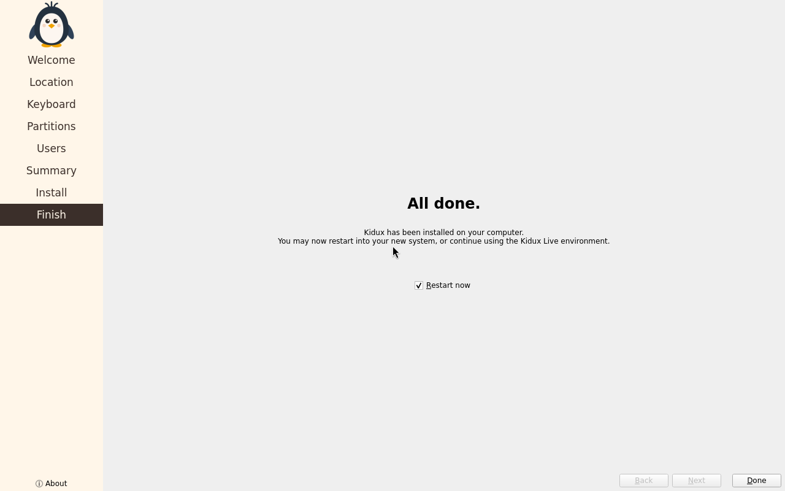

6. **Retirez la clé** quand l'ordinateur redémarre. En démarrant, il
   affiche le logo de Kidux et commence son premier démarrage. La section
   suivante, *Le premier démarrage*, décrit ce qui se passe alors.

### Sur Debian

Kidux est construit sur [Debian](https://www.debian.org/), et il s'installe
par-dessus une Debian 13 sur laquelle il n'y a rien d'autre. L'ensemble
prend environ une heure, surtout de l'attente. Une partie se tape dans une
console texte, et chaque ligne que vous aurez à taper est écrite ici.

Tout ce qui se trouve sur le disque de l'ordinateur est effacé. Copiez
ailleurs avant tout ce que vous voulez garder.

1. **Téléchargez Debian.** Sur un autre ordinateur, allez sur
   [debian.org/download](https://www.debian.org/download) et téléchargez
   la petite image d'installation. C'est un fichier dont le nom ressemble à
   `debian-13.x.0-amd64-netinst.iso`.

2. **Copiez-la sur une clé USB** de 1 Go ou plus, avec un programme comme
   [balenaEtcher](https://etcher.balena.io/) : choisissez le fichier,
   choisissez la clé et lancez l'écriture. Tout ce qui se trouve sur la clé
   est effacé.

3. **Démarrez l'ordinateur sur la clé.** Branchez la clé. Si l'ordinateur a
   une prise pour un câble réseau, branchez-en un aussi. Allumez
   l'ordinateur et ouvrez son menu de démarrage. En général, il faut
   appuyer sur F12, F11, F8, Échap ou F2 juste après l'avoir allumé, ou
   maintenir la touche Option enfoncée sur un Mac. Choisissez la clé, puis
   **Graphical install**.

   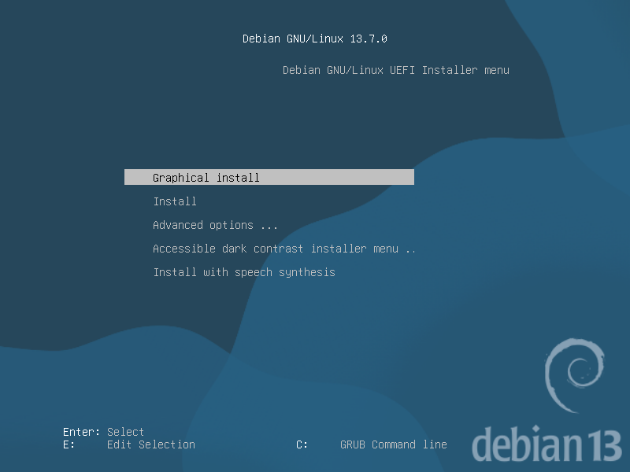

4. **Répondez à l'installateur.** Il pose une question à la fois, et
   **Continuer** passe à la suivante. La plupart des questions peuvent être
   laissées telles quelles. Voici celles qui comptent pour Kidux (les
   noms sont ceux de l'installateur de Debian en français) :

   | L'installateur demande | Réponse |
   |---|---|
   | Langue, pays, clavier | Les vôtres. Kidux demande sa propre langue et son clavier à son premier démarrage. |
   | Réseau | Avec un câble, il ne demande rien. Sans câble, choisissez votre Wi-Fi et tapez son mot de passe. |
   | Nom de machine et domaine | N'importe quel nom, `kidux` par exemple. Laissez le domaine vide. |
   | Mot de passe du superutilisateur (root) | Laissez les deux cases **vides**. L'utilisateur créé ensuite pourra alors s'occuper de l'ordinateur. |
   | Nom complet, identifiant et mot de passe | Un compte pour vous, l'adulte. Les enfants auront les leurs dans Kidux. |
   | Partitionner les disques | **Assisté - utiliser un disque entier**, le disque de l'ordinateur, et **Partition /home séparée** : le système sur une partie du disque et le travail des enfants sur une autre. Puis **Terminer le partitionnement et appliquer les changements**, et **Oui** quand il demande s'il faut appliquer les changements ; **Non** est coché d'avance. |
   | Miroir de l'archive Debian, mandataire, enquête sur les paquets | Ce qui est choisi d'avance. |
   | Sélection des logiciels | Décochez **environnement de bureau Debian** et **GNOME**, et ne laissez cochés que les **utilitaires usuels du système**. Pas de bureau : Kidux apporte ses propres écrans. |
   | Programme de démarrage GRUB | La question n'est posée que sur un ordinateur ancien. **Oui**, sur le disque de l'ordinateur. |

   Le mot de passe du superutilisateur, laissé vide :

   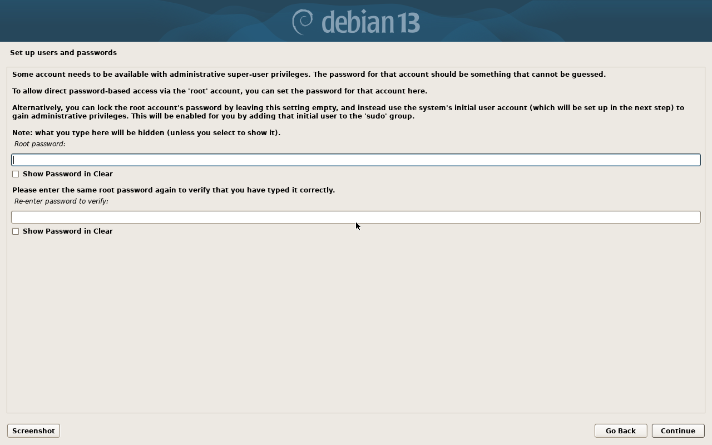

   Le schéma de partitionnement :

   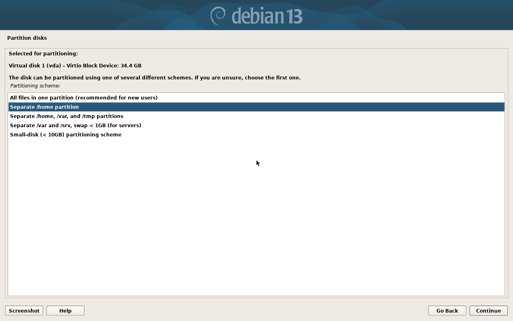

   Et les logiciels : les utilitaires usuels seuls.

   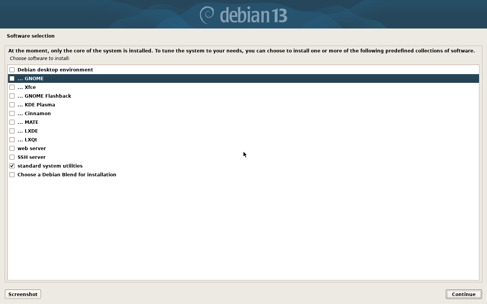

   Quand l'installateur a terminé, retirez la clé et laissez l'ordinateur
   redémarrer.

5. **Connectez-vous à Debian.** L'ordinateur démarre sur un écran texte qui
   demande un identifiant. Tapez le nom d'utilisateur et le mot de passe
   donnés à l'installateur.

6. **Installez Kidux.** Tapez ces lignes, une à la fois. Les trois
   premières récupèrent et installent l'adresse d'où viennent les paquets
   de Kidux, et la clé avec laquelle ils sont signés. Les deux dernières
   installent Kidux.

   ```
   wget https://apt.kidux.org/bootstrap/stable/kidux-archive-keyring.deb
   wget https://apt.kidux.org/bootstrap/stable/kidux-apt-source.deb
   sudo apt install ./kidux-archive-keyring.deb ./kidux-apt-source.deb
   sudo apt update
   sudo apt install kidux-base
   ```

   La première ligne qui commence par `sudo` demande votre mot de passe. La
   dernière montre ce qu'elle va installer et demande s'il faut continuer :
   appuyez sur Entrée. Cela prend quelques minutes.

   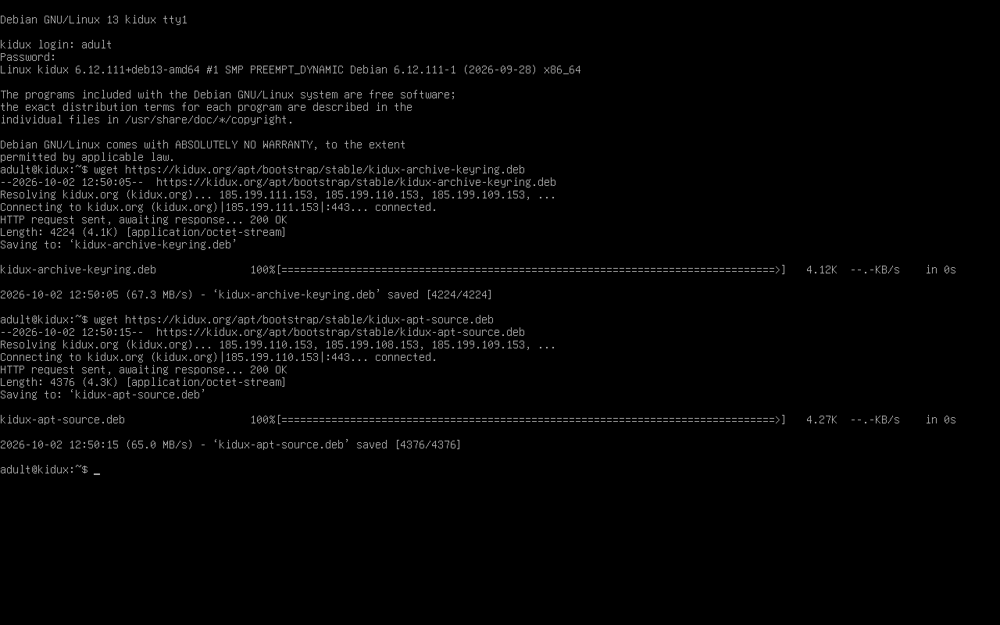

7. **Si l'ordinateur est en Wi-Fi, confiez le Wi-Fi à Kidux.** Avec un
   câble réseau, sautez cette étape.

   L'installateur de Debian a écrit le Wi-Fi auquel il s'est connecté dans
   un fichier à lui, `/etc/network/interfaces`. L'espace adulte de Kidux a
   une page **Réseau** pour se connecter à des réseaux Wi-Fi et en changer,
   mais elle ne peut pas changer un réseau écrit dans ce fichier. Retirez-le
   donc du fichier maintenant.

   Ouvrez le fichier :

   ```
   sudo nano /etc/network/interfaces
   ```

   Il ressemble à ceci. Le nom de votre carte Wi-Fi commence par `wl`, et
   le nom de votre réseau est sur la ligne qui commence par `wpa-ssid` :

   ```
   # This file describes the network interfaces available on your system
   # and how to activate them. For more information, see interfaces(5).

   source /etc/network/interfaces.d/*

   # The loopback network interface
   auto lo
   iface lo inet loopback

   # The primary network interface
   allow-hotplug wlp3s0
   iface wlp3s0 inet dhcp
           wpa-ssid MonReseau
           wpa-psk  son-mot-de-passe
   ```

   Supprimez les lignes qui nomment la carte Wi-Fi : celles qui commencent
   par `allow-hotplug` et `iface`, et les lignes en dessous qui commencent
   par `wpa-`. Laissez le reste tel quel :

   ```
   # This file describes the network interfaces available on your system
   # and how to activate them. For more information, see interfaces(5).

   source /etc/network/interfaces.d/*

   # The loopback network interface
   auto lo
   iface lo inet loopback
   ```

   Enregistrez avec Ctrl+O et Entrée, et quittez avec Ctrl+X.

8. **Redémarrez.**

   ```
   sudo reboot
   ```

   L'ordinateur affiche le logo de Kidux et démarre pour la première fois.
   La section suivante décrit ce qui se passe alors. Maintenant que le
   Wi-Fi n'est plus dans le fichier, l'ordinateur n'est connecté à aucun
   réseau tant que vous ne vous reconnectez pas depuis la page **Réseau** de
   l'espace adulte (section 8).

## 3. Le premier démarrage

À chaque démarrage, l'ordinateur affiche le logo de Kidux jusqu'à ce que
le premier écran soit prêt.

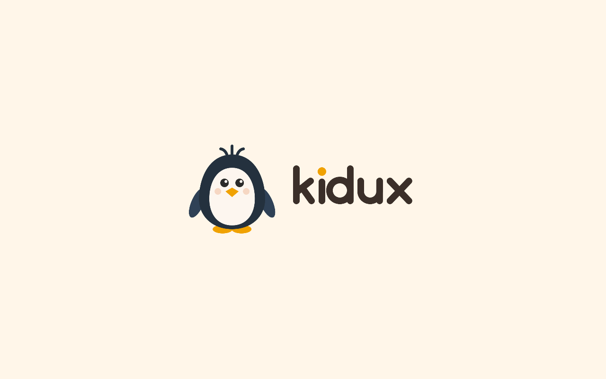

La première fois que l'ordinateur démarre, il se configure avec vous. Cela
prend quelques minutes. Vous n'avez besoin d'aucun raccourci clavier ni
d'aucun terminal : il y a six écrans, l'un après l'autre.

1. **La langue.** Choisissez la langue de l'ordinateur. Chaque langue est
   écrite dans ses propres mots, pour que vous trouviez la vôtre quelle que
   soit la langue de l'écran.

   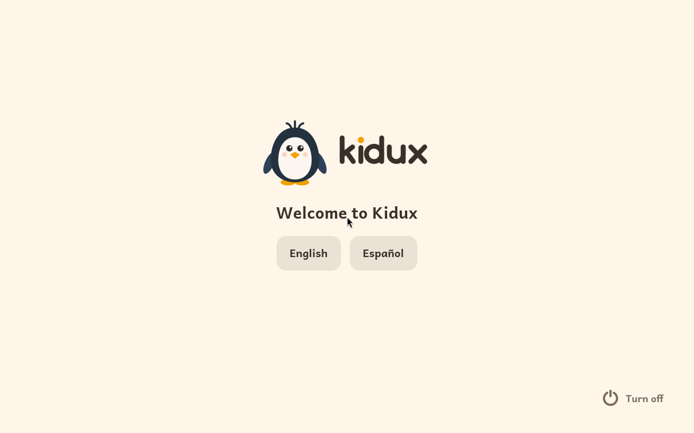

2. **Le clavier.** Choisissez le clavier de votre ordinateur. L'écran
   redémarre de lui-même pour l'utiliser. À partir de là, chaque mot de
   passe se tape avec ce clavier, sur chaque écran qui en demande un.

   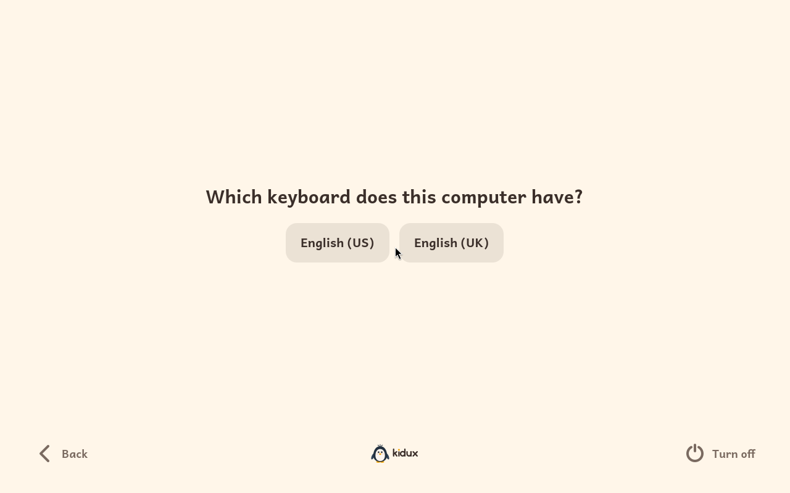

3. **Le mot de passe adulte.** Tapez-le deux fois. Ce mot de passe ouvre
   l'espace adulte, où vous décidez de tout ce qui concerne les enfants.
   Choisissez-en un que les enfants ne devineront pas, et ne les laissez
   pas vous voir le taper. Il n'y a aucune règle sur sa longueur ni sur ses
   caractères. Un mot de passe plus long est simplement plus difficile à
   deviner.

   

4. **Les statistiques d'utilisation.** Quand l'ordinateur cherche des mises
   à jour, il indique au serveur de Kidux qu'il s'agit d'un ordinateur
   Kidux. Avec cet interrupteur activé, il y ajoute un identifiant créé
   pour cet ordinateur seul, afin que le projet le compte comme un
   ordinateur. Rien d'autre n'est envoyé : ni nom, ni version, rien qui
   concerne un enfant. Il est activé ; désactivez-le si vous préférez,
   maintenant ou plus tard dans la page Système, rubrique Avancé. Appuyez
   sur **Continuer**.

   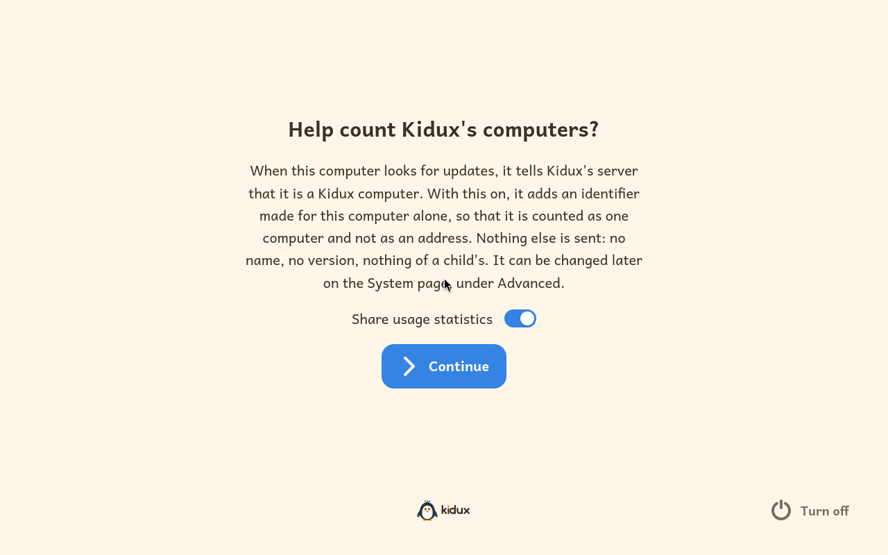

5. **Le premier enfant.** Tout ce qui concerne l'enfant tient sur un seul
   écran :

   - son prénom ;
   - une image à laquelle il se reconnaîtra ;
   - sa langue ;
   - son propre mot de passe, tapé deux fois. Pour un jeune enfant, il peut
     être très simple ;
   - la façon dont il peut utiliser l'ordinateur (section 6). Au départ,
     c'est une heure par jour.

   Un prénom et un mot de passe suffisent. Appuyez sur **Ajouter**.

   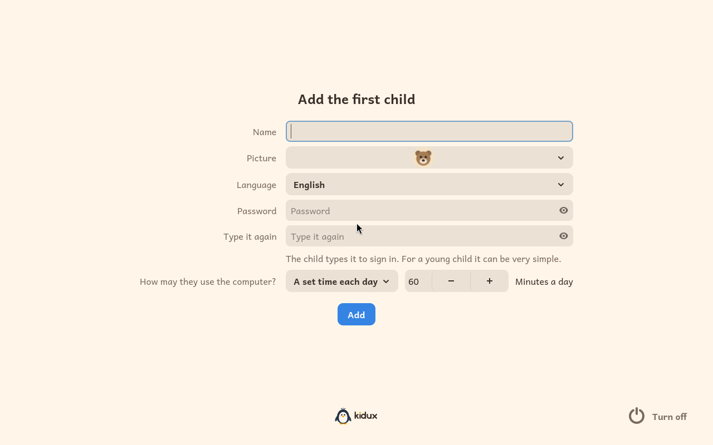

6. **C'est prêt.** L'écran de connexion apparaît, avec l'image de l'enfant.
   Tout peut être modifié plus tard depuis l'espace adulte, et d'autres
   enfants peuvent y être ajoutés.

   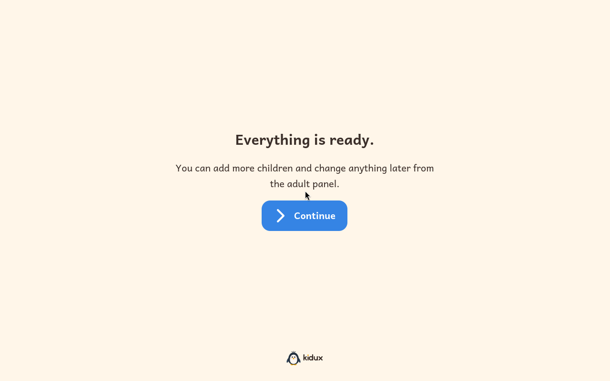

## 4. L'écran de connexion

L'ordinateur démarre toujours ici. Il y revient aussi quand un enfant quitte
sa session.

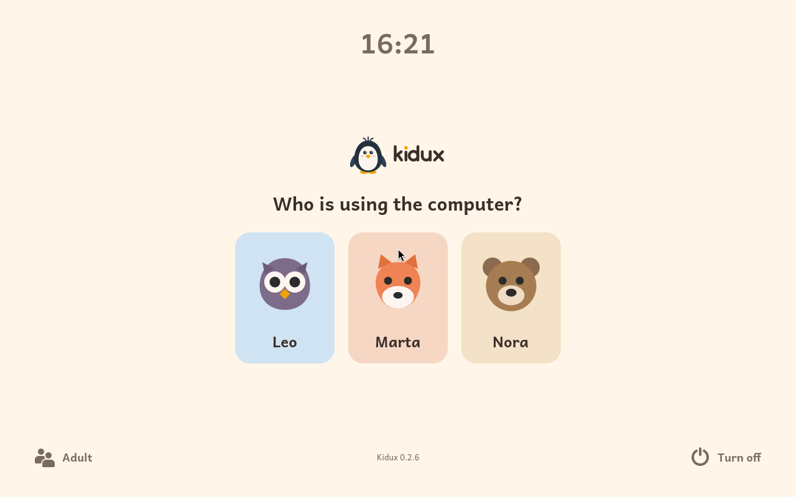

Chaque enfant a son image et son prénom. Pour entrer, un enfant touche son
image et tape son mot de passe. Dès qu'une image est touchée, l'écran passe
dans la langue de cet enfant. Deux enfants qui ont des langues différentes
voient chacun la sienne.

En bas de l'écran, en petits caractères, l'écran indique la version de
Kidux : **Kidux 0.2.3**, par exemple. Après une mise à jour, le numéro
change. L'écran de verrouillage l'indique aussi, sous le logo.

Sur un portable, le coin en haut à droite montre la batterie, le son,
l'éclairage du clavier et la luminosité de l'écran, comme sur l'écran d'un
enfant (section 5). Ce coin est présent sur cet écran, sur l'écran de
verrouillage et sur les écrans de l'adulte. Les touches propres au portable
pour ces réglages fonctionnent aussi sur tous ces écrans.

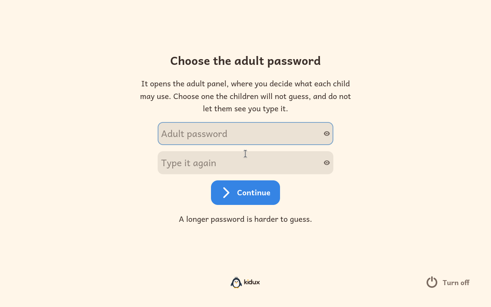

Un mauvais mot de passe n'est jamais une réprimande. L'écran dit que ce
n'est pas le bon mot de passe, et laisse l'enfant réessayer.

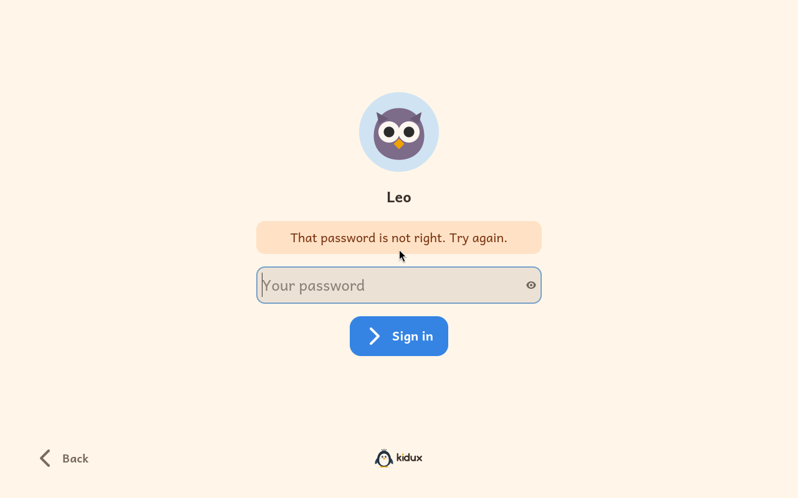

Si l'enfant a utilisé tout son temps de la journée, l'écran le dit et
propose **Demander plus de temps à un adulte**. Touchez-le et tapez le mot
de passe adulte. L'écran indique alors combien de temps il reste à
l'enfant, et propose quinze, trente ou soixante minutes, ou un nombre de
votre choix. Choisissez-en un, et l'enfant entre.

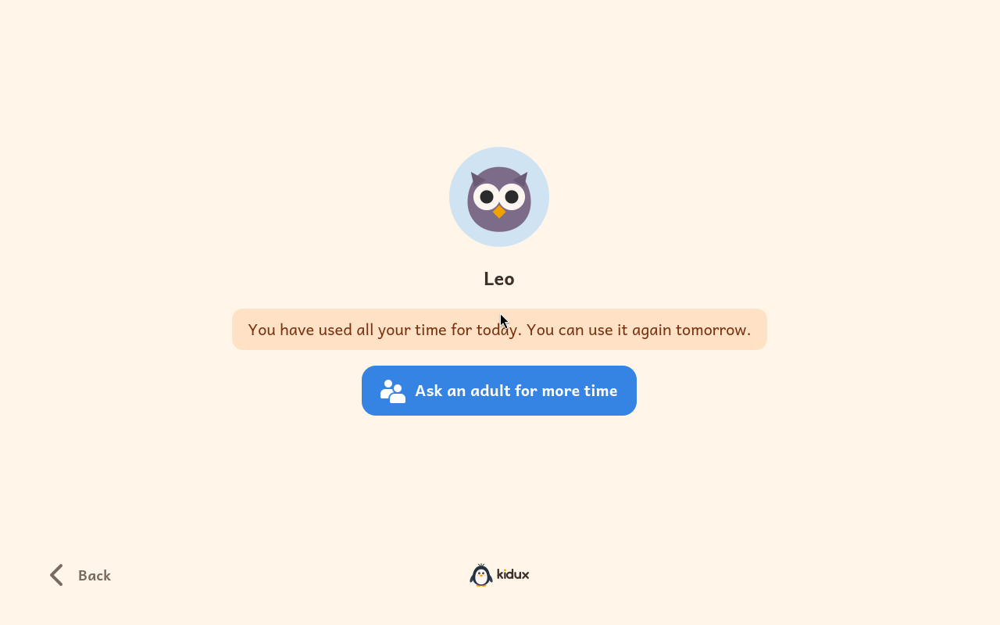

Un jour de la semaine qui n'est pas celui de l'enfant (section 6), l'écran
dit que l'ordinateur n'est pas pour lui aujourd'hui, et propose le même
**Demander plus de temps à un adulte**.

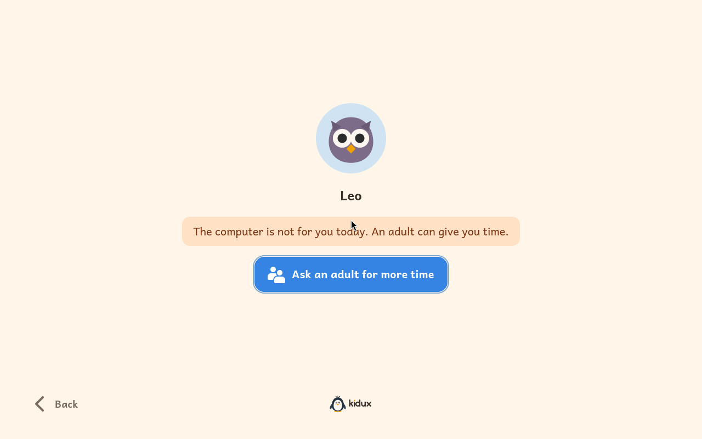

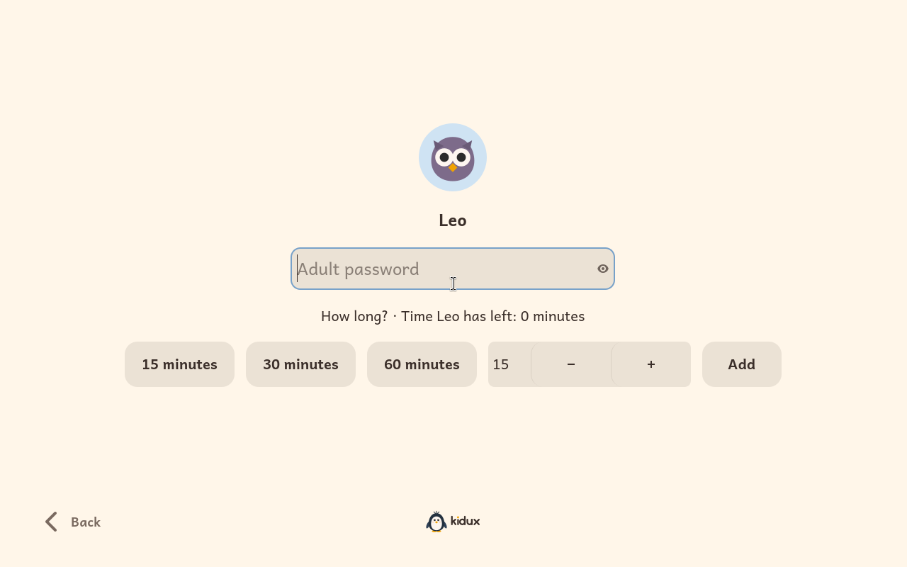

Deux autres boutons se trouvent dans les coins de l'écran :

- **Adulte**, en bas à gauche, demande le mot de passe adulte et ouvre
  l'espace adulte.
- **Éteindre**, en bas à droite, demande une fois, puis éteint ou
  redémarre l'ordinateur. Un enfant peut toujours le faire.

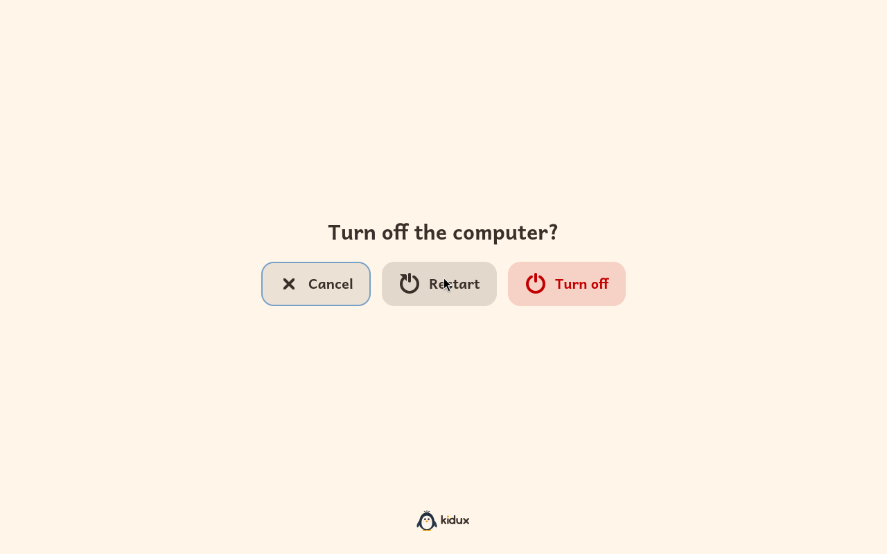

## 5. La session d'un enfant

### L'écran de l'enfant

Une fois entré, l'enfant voit son propre écran, et rien d'autre. On y
trouve :

- son image et son prénom ;
- l'horloge ;
- le temps qui lui reste aujourd'hui, quand son temps est limité. Il
  s'affiche sous forme de sablier avec les heures et les minutes,
  **00:51** par exemple. Poser le pointeur dessus, ou le toucher, dit la
  même chose en toutes lettres : *Il te reste 51 minutes* ;
- les modules d'apprentissage qu'un adulte a activés pour lui, une vignette
  chacun.

Sur un portable, le coin en haut à droite montre aussi ce que la machine
possède : la batterie et sa charge, le son, l'éclairage du clavier et la
luminosité de l'écran. Les trois derniers sont des boutons, et chacun ouvre
un curseur. Sous le curseur du son se trouve **Couper le son**. Un
ordinateur qui n'a pas l'une de ces choses ne l'affiche tout simplement pas.

Il arrive qu'un module ait quelque chose à dire à l'enfant. Messagerie, par
exemple, quand son serveur ne répond pas. Une bulle monte alors de la barre
en bas à droite, par-dessus ce qui est ouvert, et dit de quel module elle
vient. Elle disparaît d'elle-même au bout de quelques secondes. Une bulle
qui signale un problème peut rester jusqu'à ce que l'enfant la ferme avec
son **×**.

La cloche au bout à droite de la barre garde les dernières bulles, avec
l'heure de chacune, pour que l'enfant puisse en relire une qui est passée.
Un nombre à côté de la cloche indique combien il en est arrivé depuis la
dernière fois qu'elle a été ouverte, et **Effacer** vide la liste. Une
bulle ne fait jamais de bruit, et ne vient jamais d'un site web.

Un lien d'un module qui mène à Internet, comme la page d'aide d'un
programme, n'ouvre rien. À la place, une bulle dit *Ça ouvre Internet, qui
est fermé ici.*

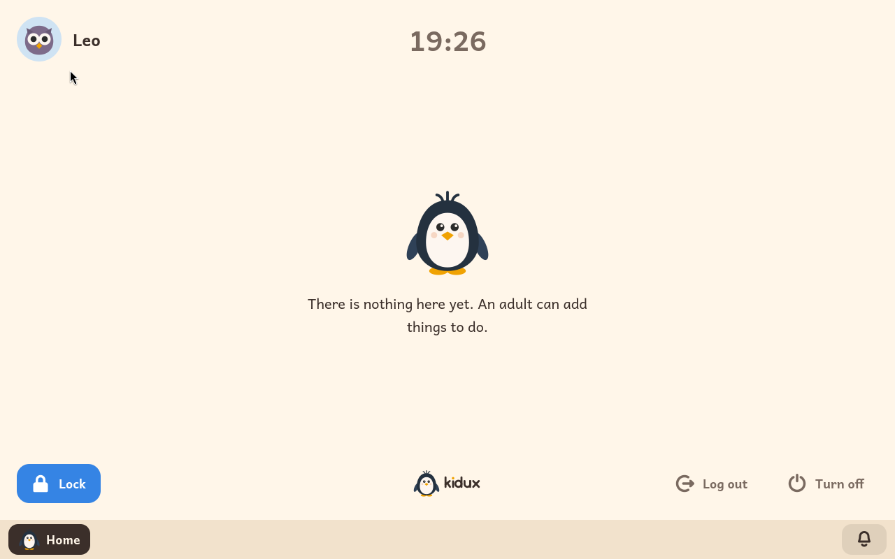

### Ouvrir un module

Chaque module activé pour l'enfant est une vignette, avec son image et son
nom dans la langue de l'enfant. L'enfant en ouvre un en le touchant. Cela
marche aussi au clavier : Tab jusqu'aux vignettes, les flèches jusqu'à
celle qu'il veut, et Entrée.

Quand il y a plus de vignettes que l'écran ne peut en contenir, une barre
apparaît à droite, et une ombre le long du bas montre qu'il y a d'autres
vignettes plus bas.

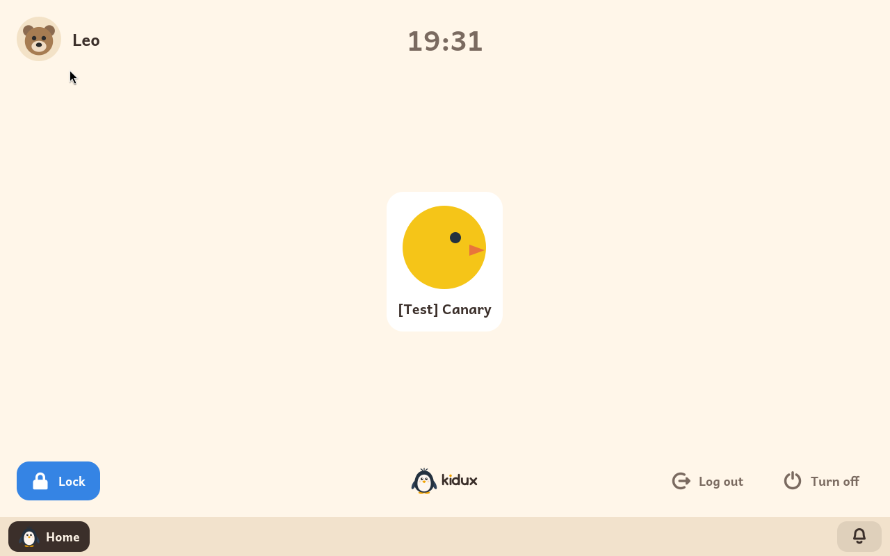

Un module s'ouvre en remplissant l'écran, au-dessus d'une barre qui reste
en bas. Plusieurs modules peuvent être ouverts en même temps, et l'enfant
passe de l'un à l'autre comme sur n'importe quel ordinateur. Toucher la
vignette d'un module déjà ouvert y conduit, plutôt que de l'ouvrir une
deuxième fois.

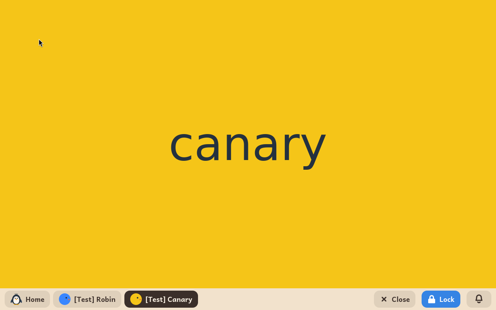

### Un guide à côté d'un module

Certains modules sont accompagnés d'un guide : des leçons écrites pour
l'enfant, avec des étapes à suivre, ce qu'il faut observer, et des idées
pour aller plus loin. Le guide s'ouvre à droite quand le module s'ouvre, et
le module prend le reste de l'écran.

**Replier**, en haut du guide, le replie en une fine bande le long du bord,
pour laisser plus de place au module. Un clic sur la bande, ou sur
**Guide** dans la barre, le rouvre, à la leçon où en était l'enfant.

Pour un enfant qui a des fenêtres, le guide reste ouvert tant qu'un module
avec un guide est ouvert, et montre le guide du module en cours
d'utilisation. Le nom en haut du guide est une liste où choisir un autre
guide, et **Épingler** garde celui qui est choisi, quelle que soit la
fenêtre utilisée.

Une leçon peut avoir une *mission* : un fichier du module, à moitié fait,
avec ce qu'il faut essayer écrit à l'intérieur. La première fois que le
guide s'ouvre, les missions sont copiées dans les **Documents** de
l'enfant, dans un dossier qui porte le nom du module. La leçon explique
comment ouvrir sa mission depuis le menu **Fichier**, **Ouvrir** du module
lui-même.

Kig, Step et Kalzium ont un guide.


### La barre

La barre du bas contient toujours :

- **Accueil**, qui ramène l'écran de l'enfant ;
- un bouton pour chaque module ouvert, celui qui est à l'écran étant mis en
  évidence. Les boutons occupent toute la place entre **Accueil** et le
  temps restant.

Quand un module est à l'écran, la barre montre aussi le temps restant (le
sablier), **Fermer** et **Verrouiller**.

**Fermer** ferme le module à l'écran. On le demande d'abord au module,
comme à n'importe quel programme dont on ferme la fenêtre, pour qu'un
module qui a du travail non enregistré puisse le signaler. Si le module est
toujours ouvert dix secondes plus tard, la barre demande s'il faut le
fermer quand même :

- **Annuler** le laisse ouvert ;
- **Fermer quand même** le ferme. Ce qui n'était pas enregistré est perdu.

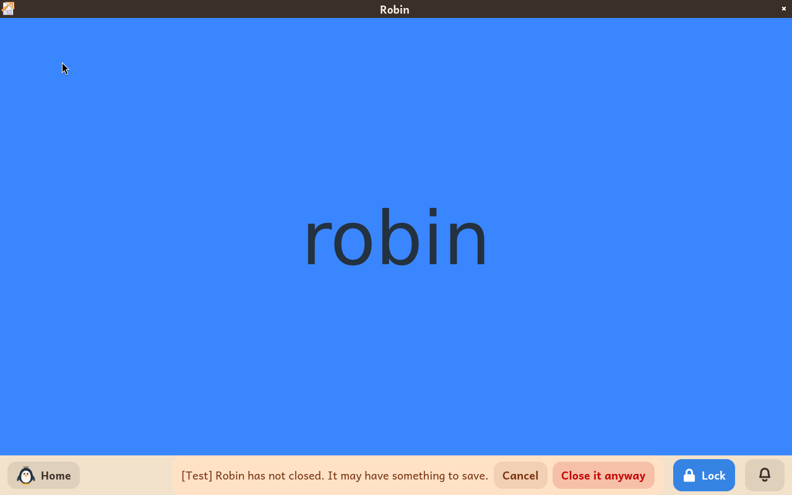

### Le clavier

Quelques touches font ce que font les boutons de la barre :

- La **touche Windows** (celle avec le logo ; **⌘** sur un clavier de Mac),
  pressée seule, ramène à l'accueil.
- **Alt+Tab** passe d'un module ouvert à l'autre, dans l'ordre de la barre.
  Elle va au suivant, à droite du module à l'écran, et du dernier revient
  au premier. Depuis l'écran de l'enfant, elle va au premier. Tant que
  **Alt** est maintenue, chaque appui sur **Tab** éclaire le module suivant
  dans la barre, et relâcher **Alt** conduit à celui qui est éclairé.
  **Alt+Maj+Tab** fait le tour dans l'autre sens. Alt+Tab ne va jamais à
  l'écran de l'enfant : c'est le rôle de la touche Windows. Avec un seul
  module ouvert, et à l'écran, elle ne fait rien.
- **Alt+F4** correspond à **Fermer**. Pressée à nouveau pendant que la
  barre pose sa question, elle ferme le module quand même.

Poser le pointeur sur un bouton de la barre montre la touche qui fait la
même chose, pour que l'enfant apprenne les touches. Sur un Mac, où F4
demande la touche fn, **Fermer** indique **Alt+(fn)F4**. Le module auquel
Alt+Tab conduirait indique **Alt+Tab**.

### Les touches propres à un portable et son capot

Les touches d'un portable pour la luminosité de l'écran, l'éclairage du
clavier et le son (plus fort, moins fort et couper le son) font ce qu'elles
indiquent, dans n'importe quel module. Le coin de l'écran de l'enfant
montre aussitôt le nouveau niveau.

Fermer le capot verrouille la session de l'enfant et éteint l'écran et
l'éclairage du clavier ; puis l'ordinateur se met en veille, comme
l'indique la page **Mise en veille** de l'espace adulte (section 8). Ouvrir
le capot le réveille et rallume l'écran, avec l'éclairage tel qu'il était,
sur l'écran de verrouillage, où l'enfant tape son mot de passe pour
continuer. Le temps ne compte pas tant que le capot est fermé.

Les mêmes touches fonctionnent sur l'écran de connexion et sur l'écran de
verrouillage, et y fermer le capot éteint aussi l'écran et l'éclairage du
clavier.

### Les fichiers, verrouiller et quitter

Un fichier que l'enfant crée dans un module est gardé dans ses propres
dossiers, où n'importe quel autre module peut l'ouvrir.

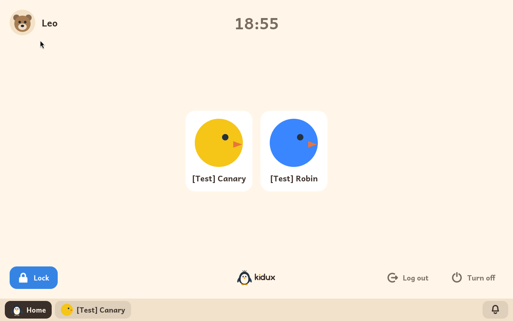

Trois boutons se trouvent en bas de l'écran de l'enfant :

- **Verrouiller**, en bas à gauche, verrouille l'écran tout de suite. C'est
  ainsi qu'un enfant s'absente sans dépenser de temps : le temps ne compte
  pas tant que l'écran est verrouillé, et tout reste exactement comme
  c'était.
- **Quitter** termine la session et ramène l'écran de connexion. Il demande
  d'abord si le travail de l'enfant est enregistré, car quitter ferme tous
  les modules.
- **Éteindre** fait apparaître l'écran de verrouillage, d'où l'ordinateur
  peut être éteint.

Une session laissée sans activité se verrouille aussi d'elle-même. Après
cinq minutes sans que personne ne touche au clavier ou à la souris, l'écran
se verrouille, comme le ferait un économiseur d'écran. Un module qui joue
tout seul ne fait pas exception. Après dix minutes, l'écran s'éteint, et
l'éclairage du clavier avec lui. Cela se passe sur chaque écran de
l'ordinateur, y compris les écrans de connexion et de verrouillage, et le
premier contact les rallume. Un adulte peut changer ces deux durées dans la
page **Système** de l'espace adulte (section 8).

Verrouiller l'écran laisse chaque module exactement où il en était.
Quitter, depuis l'écran de l'enfant ou depuis l'écran de verrouillage,
ferme tous les modules avec la session : mieux vaut donc enregistrer
d'abord.

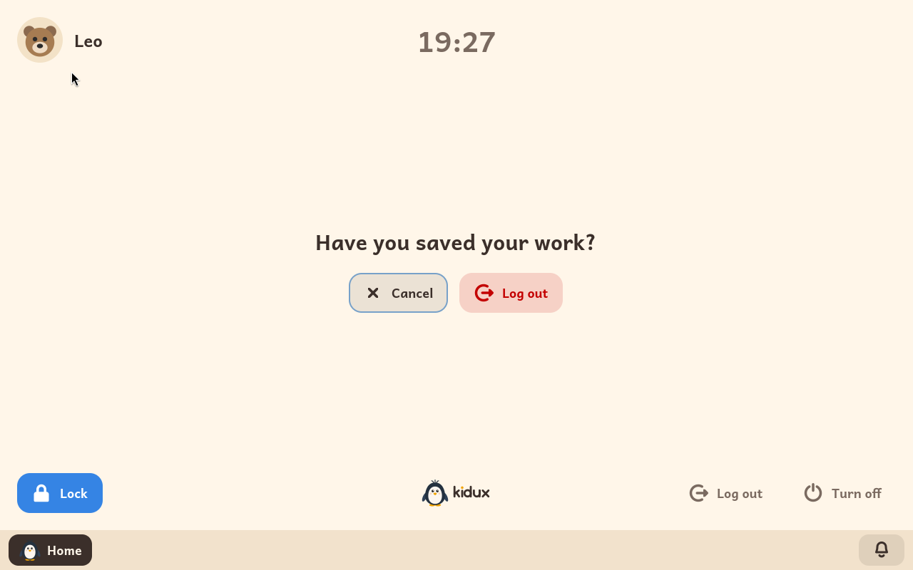

### Quand le temps est sur le point de finir

Dix, cinq et une minute avant la fin du temps de l'enfant, une bulle de
Kidux monte de la barre et lui dit d'enregistrer son travail. Elle reste
jusqu'à ce que l'enfant la ferme, et la suivante prend sa place. Quand le
temps est écoulé, l'écran de verrouillage apparaît de lui-même.

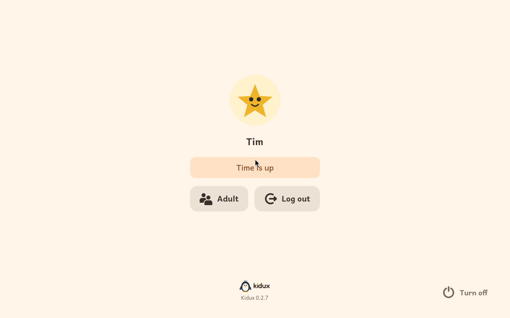

## 6. Le temps

Chaque enfant utilise l'ordinateur de l'une de trois façons. Un adulte
choisit laquelle :

- **Quand il veut.** Il n'y a pas de limite. L'ordinateur compte quand même
  le temps passé par l'enfant, pour qu'un adulte puisse le voir.
- **Un temps fixe chaque jour.** Tant de minutes par jour. Le temps compte
  tant que la session est déverrouillée, que l'enfant fasse quelque chose
  ou non, et il s'arrête quand l'écran est verrouillé. La journée
  recommence à quatre heures du matin, pas à minuit, pour qu'une session du
  soir ne soit pas coupée en deux. Le temps supplémentaire qu'un adulte
  donne ce jour-là dure jusqu'à la fin de la journée.
- **Seulement quand un adulte le permet.** L'enfant ne peut pas entrer tant
  qu'un adulte ne lui a pas donné de temps, sur l'écran de connexion. Le
  temps donné ainsi est gardé jusqu'à ce qu'il soit utilisé, même d'un jour
  à l'autre.

Les deux premières façons s'appliquent les **jours** de la semaine qu'un
adulte coche. Pour un nouvel enfant, tous les jours sont cochés. Les autres
jours, l'ordinateur n'est pas pour l'enfant : il ne peut pas entrer à moins
qu'un adulte lui donne du temps, et ce temps dure jusqu'à la fin de la
journée. Un enfant qui utilise encore l'ordinateur quand un tel jour
commence, à quatre heures du matin, trouve l'écran verrouillé, comme
lorsque son temps est écoulé.

Deux choses sont bonnes à savoir :

- Le temps compte tant que la session est déverrouillée. Une session
  laissée ouverte pendant le dîner consomme le temps de la journée.
  L'enfant devrait verrouiller l'écran chaque fois qu'il s'absente.
- Le temps déjà utilisé est conservé après un redémarrage, une coupure de
  courant ou un plantage.

## 7. L'écran de verrouillage

L'écran de verrouillage apparaît par-dessus la session d'un enfant quand
son temps est écoulé, quand l'enfant verrouille l'écran, quand la session
reste sans activité quelques minutes, quand le capot d'un portable est
fermé, et chaque fois que quelqu'un appuie sur le bouton d'alimentation de
l'ordinateur. Ce que faisait l'enfant reste exactement comme c'était,
en dessous, et plus rien de ce qui lui appartient ne tourne.

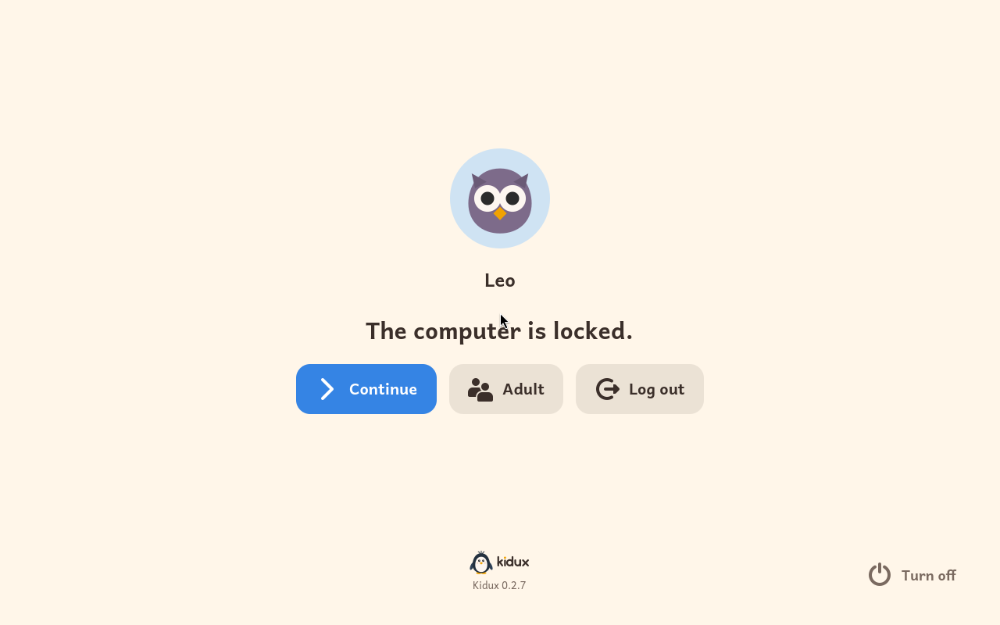

L'écran de verrouillage propose quatre choses :

- **Continuer.** L'enfant tape son propre mot de passe et reprend, tant
  qu'il lui reste du temps.
- **Adulte.** Tapez le mot de passe adulte, puis choisissez l'une de quatre
  choses :
  - **donner plus de temps**, avec sous les yeux le temps qu'il reste à
    l'enfant ;
  - **déverrouiller pour enregistrer le travail**, qui déverrouille l'écran
    quelques minutes sans les compter, pour que l'enfant puisse enregistrer
    et verrouiller à nouveau ;
  - **quitter**, qui termine la session ;
  - l'**espace adulte** (section 8).
- **Quitter.** L'enfant tape son propre mot de passe et la session se
  termine.
- **Éteindre.** Il demande une fois, puis éteint l'ordinateur.

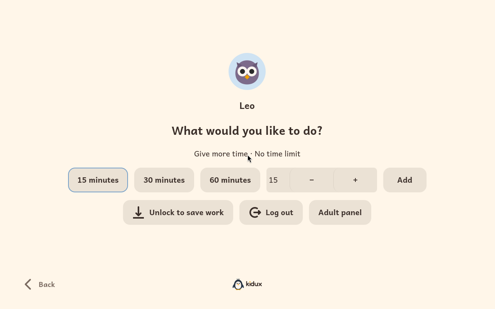

Le bouton d'alimentation n'éteint jamais l'ordinateur de lui-même. Il fait
toujours apparaître cet écran. Ainsi, un mot de passe n'est jamais tapé que
sur un écran qui appartient vraiment à Kidux, et jamais sur quelque chose
qu'un programme de l'enfant aurait dessiné pour lui ressembler.

## 8. L'espace adulte

### L'ouvrir et le fermer

Appuyez sur **Adulte** sur l'écran de connexion, ou sur **Adulte** puis
**Espace adulte** sur l'écran de verrouillage, et tapez le mot de passe
adulte. L'espace adulte couvre tout l'écran. Il se ferme avec **Fermer**,
avec la touche Échap, ou de lui-même après cinq minutes sans contact (ou
après les minutes réglées dans la page **Système** pour un ordinateur
laissé sans activité). Personne ne peut le laisser ouvert par erreur.

Une habitude garde le mot de passe adulte pour vous seul : **appuyez sur le
bouton d'alimentation de l'ordinateur avant de le taper**, chaque fois
qu'un enfant a utilisé l'ordinateur. Le bouton d'alimentation fait toujours
apparaître l'écran de verrouillage, qui appartient à Kidux. L'écran sur
lequel vous tapez ensuite n'est donc jamais quelque chose qu'un programme
de l'enfant a dessiné.

L'espace adulte a quatre pages : **Enfants**, **Modules**, **Système** et
**Réseau**. Chaque page tient sur un écran, et tout se modifie sur place,
sans passer d'un écran à l'autre.

Quand une page contient plus que ce que l'écran peut afficher, avec
beaucoup d'enfants ou de modules, ou sur un petit écran, une barre apparaît
à sa droite ou le long de son bas, et une ombre apparaît sur le bord où la
page continue. Faites glisser la barre, ou faites défiler, pour voir la
suite. Tous les écrans de Kidux font de même.

### Enfants

En haut de la page se trouvent tous les enfants, celui qui est choisi étant
mis en évidence, et **Ajouter un enfant**.

En dessous se trouve le temps de l'enfant choisi :

- le temps qu'il a utilisé aujourd'hui ;
- des boutons pour **donner plus de temps** tout de suite ;
- **Reste aujourd'hui** : le nombre de minutes qu'il lui reste. Vous pouvez
  le changer pour n'importe quel nombre, zéro compris, et appuyer sur
  **Définir**. Le mettre à zéro termine son temps maintenant, même s'il est
  en train d'utiliser l'ordinateur : l'écran de verrouillage apparaît
  aussitôt.

En dessous se trouve tout ce qui concerne l'enfant :

- son prénom ;
- son image ;
- sa langue ;
- un nouveau mot de passe, si vous voulez le changer ;
- la façon dont il peut utiliser l'ordinateur (section 6), et les **jours**
  de la semaine où elle s'applique, du lundi au dimanche ;
- **Fenêtres**, expliqué plus bas.

Modifiez ce que vous voulez et appuyez sur **Enregistrer**. Ce qui ne peut
pas être enregistré est signalé à son emplacement, et le reste est
enregistré. **Ajouter un enfant** montre la même page, vide.

**Supprimer** demande une fois, sur la même page. Supprimer un enfant
efface son compte et tout ce qu'il contient. **Supprimer, mais garder ses
fichiers** efface le compte mais laisse les fichiers de l'enfant sur
l'ordinateur. Un enfant qui a une session ouverte ne peut pas être
supprimé tant qu'il ne l'a pas quittée.

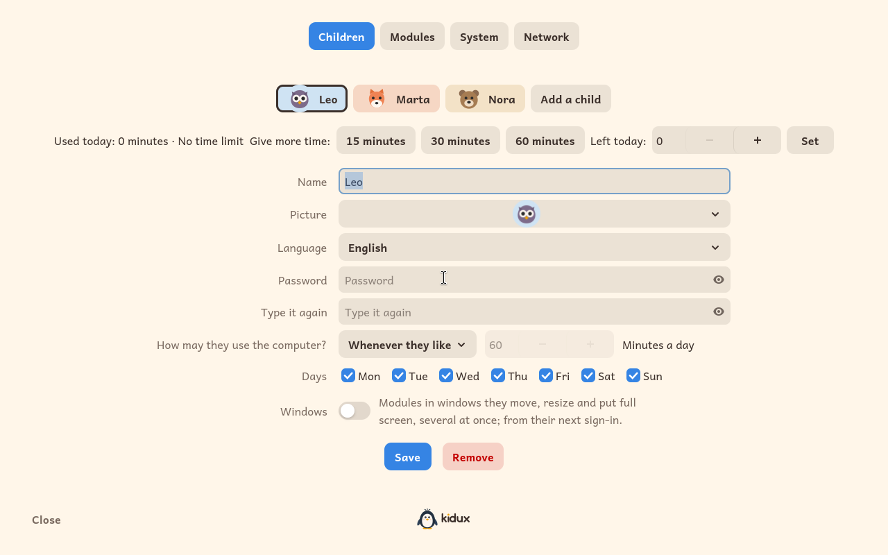

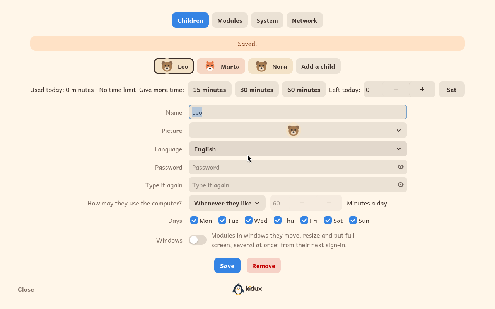

### Fenêtres

**Fenêtres** est désactivé pour un nouvel enfant. Chaque module
d'apprentissage remplit alors l'écran au-dessus de la barre, ce qui est le
plus simple pour un jeune enfant.

Avec **Fenêtres** activé, les modules de l'enfant s'ouvrent dans des
fenêtres, plusieurs à la fois, comme sur n'importe quel ordinateur :

- chaque fenêtre a une barre de titre pour la déplacer, des bords pour la
  redimensionner, et des boutons pour la réduire, l'agrandir et la fermer ;
- ce qui est copié dans une fenêtre peut être collé dans une autre ;
- la barre a un bouton pour chaque fenêtre. Celle qui est utilisée est mise
  en évidence, et une fenêtre réduite est plus pâle. Toucher un bouton fait
  passer sa fenêtre au premier plan. Quand il y a plus de boutons que de
  place, une flèche à chaque bout fait apparaître les autres ;
- **Accueil**, et la touche Windows, montrent le bureau : toutes les
  fenêtres réduites et les vignettes de l'enfant visibles. Toucher une
  vignette, ou le bouton d'une fenêtre dans la barre, ramène les fenêtres
  comme elles étaient, avec celle demandée devant. Une fenêtre que l'enfant
  a réduite reste réduite.

Le changement s'applique la prochaine fois que l'enfant entre.

Certains modules d'apprentissage, un vrai navigateur web par exemple, ne
fonctionnent qu'avec des fenêtres. Ils l'indiquent dans la page
**Modules**, où ils ne peuvent pas être activés pour un enfant sans
fenêtres.

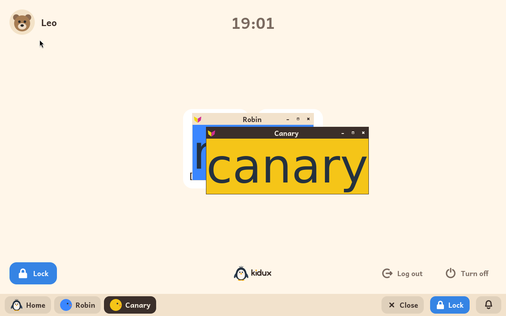

### Modules

La page **Modules** liste chaque module d'apprentissage installé sur
l'ordinateur, avec son nom et ce à quoi il sert. À côté du nom, en plus
petits caractères, figurent les âges auxquels le module est destiné et sa
version. En dessous, quand il y en a, **Modules recommandés avant :**
nomme les modules qu'il vaut mieux faire d'abord. C'est un conseil :
n'importe quel module peut être activé pour n'importe quel enfant.

Les deux listes sont classées par âge recommandé, des modules pour les plus
jeunes à ceux pour les plus grands. La case de recherche **Trouver un
module**, en haut, filtre les listes pour ne montrer que les modules dont
le nom ou la description correspond à ce que vous tapez.

Chaque module a un interrupteur pour chaque enfant, sous l'image de
l'enfant. Un interrupteur est enregistré dès que vous le basculez, et
l'écran de l'enfant suit aussitôt, même s'il est en train d'utiliser
l'ordinateur.

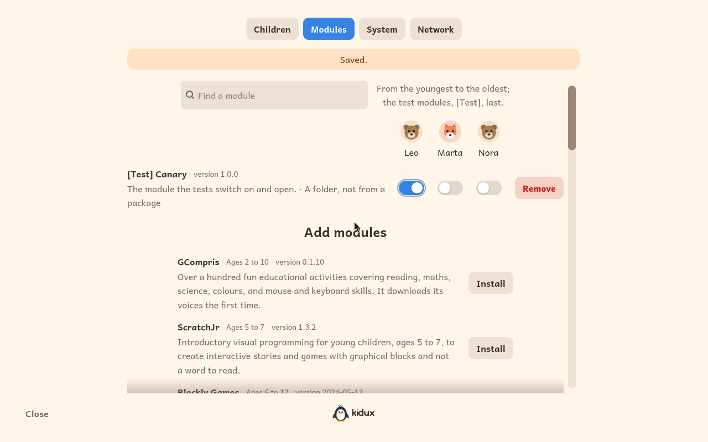

Sous les modules installés, **Ajouter des modules** liste les modules
d'apprentissage proposés par Kidux qui ne sont pas encore sur l'ordinateur,
avec les mêmes âges et les modules à faire d'abord.

- **Installer** en ajoute un. Le module monte aussitôt parmi les modules
  installés, avec une barre qui montre où en est l'installation, à
  l'endroit où seront ses interrupteurs. Quand c'est fait, le module est
  désactivé pour chaque enfant, et un message en bas de la page le dit. La
  page reste à vous pendant ce temps : vous pouvez la faire défiler, et
  installer ou supprimer d'autres modules. Ils attendent leur tour, chaque
  ligne indiquant *En attente…*, et passent l'un après l'autre.
- **Réglages** apparaît sur la ligne d'un module qui a des réglages. Il
  ouvre ce qu'un adulte peut régler dans ce module pour chaque enfant : une
  colonne par enfant, et chaque réglage avec ce qu'il fait écrit en
  dessous. Une modification est enregistrée dès qu'elle est faite. Le
  réglage de BASIC est *Tape-le pour moi* : désactivé, l'enfant tape
  lui-même chaque programme du guide.
- **Supprimer**, au bout de la ligne d'un module installé, demande une
  fois, sur cette ligne, et retire le module de l'ordinateur, avec les
  programmes qui n'avaient été installés que pour lui. Ce que chaque enfant
  a créé avec reste dans ses propres dossiers. Ce que le module gardait
  pour chaque enfant, comme sa progression et ses réglages, reste aussi, et
  le module le retrouve s'il est réinstallé.
- **Chercher des modules** demande à Kidux ce qu'il propose maintenant. Il
  faut une connexion à Internet.

Les modules ne s'installent et ne se suppriment que lorsqu'aucun enfant n'a
de session ouverte, pour que rien de ce qu'un enfant utilise ne change sous
ses yeux.

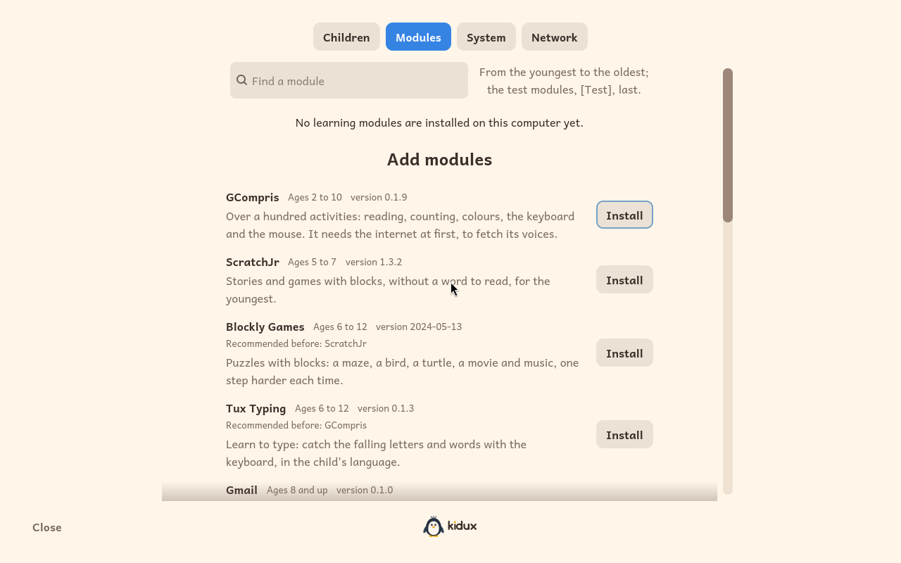

### Système

La page **Système** contient, de haut en bas :

- **La version de Kidux**, et en dessous, en plus petit, la version de
  chacune de ses parties. C'est ce qu'il faut donner à quiconque vous aide
  à trouver ce qui ne va pas. À côté de la version se trouvent les mises à
  jour (section 10).
- **Le mot de passe de secours.** Il permet de démarrer l'ordinateur
  autrement depuis le menu de démarrage, si Kidux ne démarre plus
  (section 11). Notez-le en lieu sûr.
- **Le changement du mot de passe adulte**, en tapant l'actuel puis le
  nouveau deux fois.
- **La langue et le clavier de l'ordinateur.**
- **La taille de tout ce qui est à l'écran.** Elle est sur
  **Automatique** tant que vous ne choisissez pas, et la taille qui en
  résulte est indiquée entre parenthèses : **Automatique (175 %\*)**, par
  exemple. Automatique veut dire aussi grand que l'écran le permet en
  gardant de la place. Choisissez une taille plus petite pour avoir plus
  de place sur un grand écran, ou plus grande pour tout agrandir.

  Les tailles marquées d'un \* ne sont pas des multiples entiers de 100 %.
  Un module d'apprentissage fait pour X11, l'ancien système d'affichage de
  Linux, peut paraître flou à l'une d'elles. Si c'est le cas, choisissez
  une taille sans \*.

  Une taille plus grande laisse moins de place. À 200 %, un écran de 1280
  sur 800 a la place d'un écran de 640 sur 400. Kidux est fait pour la
  place d'un 1280 sur 800. Avec moins, certains de ses écrans défilent, et
  certains modules d'apprentissage peuvent mal s'afficher.
- **Sans activité** : après combien de minutes sans contact la session
  d'un enfant se verrouille d'elle-même (cinq, au départ), et après combien
  n'importe quel écran de l'ordinateur s'éteint (dix). Le premier nombre
  est aussi la durée pendant laquelle cet espace reste ouvert. Changez l'un
  ou l'autre nombre, puis appuyez sur **Définir**. L'espace adulte prend
  les nouveaux nombres aussitôt ; la session d'un enfant les prend la
  prochaine fois que l'enfant entre.

La langue, le clavier et la taille sont enregistrés dès que vous les
choisissez :

- sur l'écran de connexion, ils s'appliquent quand vous fermez l'espace
  adulte. L'écran redémarre avec eux, ce qui prend un instant ;
- sur l'écran de verrouillage, ils s'appliquent au prochain démarrage d'un
  écran, puisque l'écran de verrouillage ne peut pas redémarrer par-dessus
  la session d'un enfant ;
- l'écran d'un enfant les prend la prochaine fois que l'enfant entre.

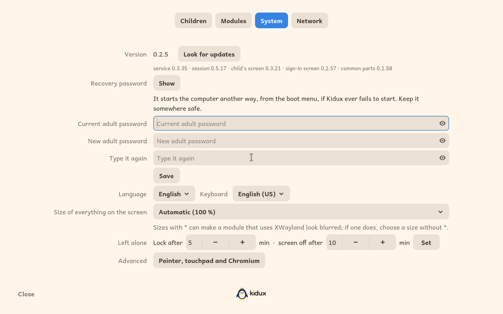

### Avancé

**Avancé**, à la fin de la page Système, concerne la façon dont le
pointeur de cet ordinateur se déplace, et les cas où quelque chose ne
fonctionne pas sur cet ordinateur en particulier.

**Vitesse du pointeur** et **Défilement à deux doigts** ont chacun cinq
crans, de *Beaucoup plus lent* à *Beaucoup plus rapide*, et sont
enregistrés dès qu'un cran est choisi. Ils s'appliquent à la session d'un
enfant à partir de sa prochaine connexion. L'écran de connexion, l'écran
de verrouillage et cet espace gardent les réglages propres à l'ordinateur.
Deux doigts sur un pavé tactile font défiler la page. En *Normal*, ils la
font défiler deux fois moins loin que la plupart des ordinateurs, ce qui
convient aux petits mouvements d'un enfant, et *Beaucoup plus rapide*
correspond à la plupart des ordinateurs. Essayez un cran avec les doigts
de l'enfant avant de le garder.

**Options de Chromium** sert pour un module d'apprentissage fait de pages
web, ou pour ScratchJr, qui contient Chromium, quand il s'affiche mal sur
l'écran de cet ordinateur : avec des taches de bruit ou des restes
d'anciennes images, ou avec une image qui ne change que lorsque le pointeur
bouge. Une option écrite dans la case, une par ligne, change la façon dont
Chromium dessine. Elle prend effet la prochaine fois que le module est
ouvert.

Sous la case, la page liste les options qui valent la peine d'être
essayées, dans l'ordre où les essayer, chacune avec ce qu'elle fait. Vous
pouvez sélectionner leurs lettres et les copier dans la case. Laissez la
case vide, sauf si vous savez de quelle option votre ordinateur a besoin :
vide, c'est ce que Kidux fait de lui-même.

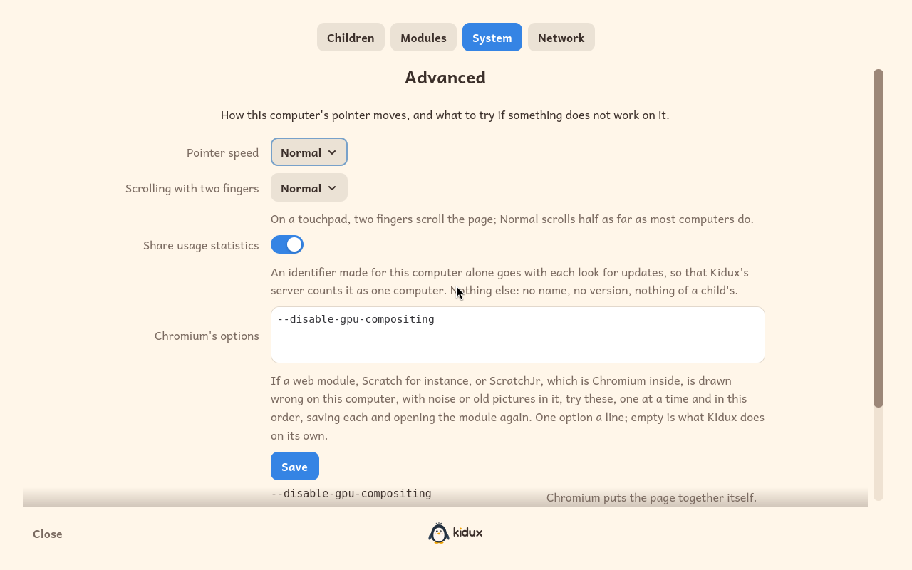

### Mise en veille

**Mise en veille**, à côté d'**Avancé** à la fin de la page Système,
concerne ce que fait l'ordinateur quand son capot se ferme, et quand
personne ne l'utilise pendant un moment. En veille, il consomme un peu de
batterie, et revient aussitôt, là où il en était, quand le capot s'ouvre ou
qu'une touche est pressée. Kidux ne se met jamais en hibernation,
c'est-à-dire qu'il n'enregistre jamais sa mémoire sur le disque pour
s'éteindre : sur certains ordinateurs, le démarrage suivant ne parvient pas
à restaurer ce qui a été enregistré, et l'ordinateur ne démarre plus.

**À la fermeture du capot** peut être **Mettre en veille**, ce que fait
Kidux tant que vous ne choisissez pas, ou **Rien** : le capot ne fait que
verrouiller la session et éteindre l'écran. C'est pareil sur batterie et
sur secteur. Si un autre écran est branché, fermer le capot éteint
seulement l'écran du portable, et l'ordinateur reste allumé. Le choix
s'applique dès qu'il est fait.

**En cas d'inactivité** est ce qui se passe quand personne ne touche
l'ordinateur pendant quelques minutes, vingt au départ : **Mettre en
veille**, ou **Éteindre seulement l'écran**. Choisissez l'un des deux et
les minutes, puis appuyez sur **Définir**. Les écrans de connexion et de
verrouillage le prennent à leur prochain démarrage, la session d'un enfant
à la prochaine connexion de l'enfant. L'écran peut s'éteindre plus tôt :
c'est la ligne **Sans activité** de la page Système. Rien ne se passe
pendant qu'une vidéo est lue ou qu'un programme demande à l'ordinateur de
rester allumé. Chaque écran compte ses propres minutes : la session d'un
enfant laissée sans activité se verrouille d'abord, et l'écran de
verrouillage compte alors depuis le début.

Avant que l'ordinateur se mette en veille, pour quelque raison que ce soit,
la session d'un enfant se verrouille, pour que le temps d'un enfant ne soit
jamais consommé pendant que l'ordinateur dort. Sur un ordinateur qui ne
peut pas se mettre en veille, la page le signale par un avertissement, et
fermer le capot ou le laisser inactif ne fait que le verrouiller et
éteindre l'écran.


### Réseau

La page **Réseau** montre comment cet ordinateur est connecté :

- **Connexion** : chaque connexion sur une ligne, Wi-Fi ou câble, avec le
  nom du réseau, son signal et l'adresse de l'ordinateur, ou **Non
  connecté**.
- **Routeur** : si le routeur, la box par laquelle passe la connexion,
  répond.
- **Chercher à nouveau** interroge à nouveau le routeur et recherche les
  réseaux Wi-Fi. La page le fait d'elle-même quand elle s'ouvre.

Quand le Wi-Fi de l'ordinateur peut être modifié d'ici, les réseaux Wi-Fi à
portée sont listés en dessous, celui qui est utilisé en premier. Chacun
indique son signal, et un cadenas s'il a un mot de passe.

- **Se connecter** rejoint un réseau. Quand le réseau demande un mot de
  passe, la page le demande sur la même ligne. L'ordinateur garde le mot de
  passe, et se reconnecte ensuite au réseau de lui-même, avant même que
  quelqu'un entre.
- **Oublier** fait que l'ordinateur ne se connecte plus de lui-même à un
  réseau. Il demande d'abord.

Changer de réseau peut laisser les modules des enfants sans connexion
pendant un moment.

La page peut se connecter au réseau d'une maison ou d'un café, avec ou sans
mot de passe. Un réseau de bureau ou d'école qui demande son propre nom
d'utilisateur ne peut pas être configuré ici.

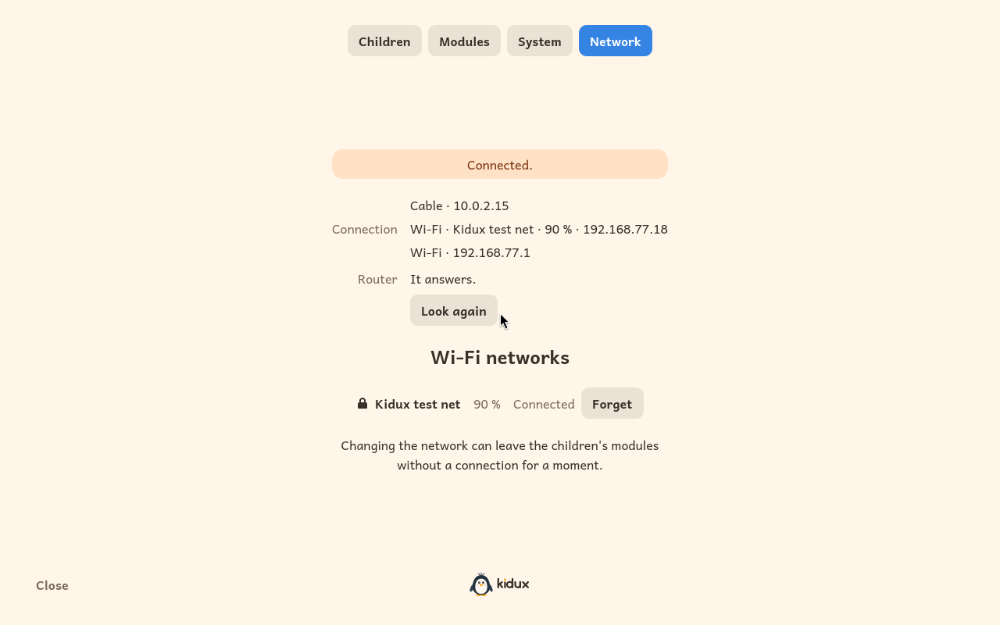

### Un Wi-Fi configuré à l'installation de Debian

Si la page Réseau indique que le Wi-Fi a été configuré à l'installation de
Debian, elle montre la connexion mais ne peut pas la modifier, car
l'installateur de Debian a configuré le Wi-Fi à sa façon. Pour le modifier
depuis la page, confiez-le à Kidux une fois pour toutes. Faites-le devant
l'ordinateur lui-même, pas depuis un autre ordinateur connecté à lui par ce
Wi-Fi.

1. Ouvrez une console texte. La section 11 explique comment.

2. Ouvrez le fichier de l'installateur :

   ```
   sudo nano /etc/network/interfaces
   ```

3. Trouvez les lignes qui commencent par `allow-hotplug` ou `iface` et qui
   nomment la carte Wi-Fi. Son nom commence par `wl`. Supprimez ces lignes,
   et les lignes en dessous qui commencent par `wpa-`. Enregistrez le
   fichier.

4. Redémarrez l'ordinateur :

   ```
   sudo reboot
   ```

La façon dont l'installateur faisait fonctionner le Wi-Fi s'arrête avec le
redémarrage. À partir de là, c'est Kidux qui fait fonctionner la carte
Wi-Fi. Quand l'écran de connexion est revenu, ouvrez l'espace adulte, allez
dans **Réseau**, et connectez-vous au Wi-Fi depuis la page avec son mot de
passe. Dès lors, la page peut le modifier.

## 9. Modules d'apprentissage

Chaque module d'apprentissage est quelque chose qu'un enfant peut ouvrir
depuis son écran. Un adulte active chaque module pour chaque enfant, dans
la page **Modules** de l'espace adulte (section 8).

Certains modules sont faits de pages web. Ils s'ouvrent en plein écran
au-dessus de la barre, dans le navigateur web Chromium, sans barre
d'adresse ni onglets, et ne montrent jamais que leurs propres pages. Un
lien qui en sort vers ailleurs ne mène nulle part. Les mots de Chromium
lui-même, sur la page qu'il affiche à la place d'une page bloquée ou dans
ses menus, sont dans la langue de l'enfant. Chromium est un gros programme,
d'environ 300 Mo, et il arrive avec le premier module de ce genre.

Quelques modules sont une porte vers un seul site sur Internet. Ils
montrent ce site et rien d'autre d'Internet. Un lien vers tout autre site
ne mène nulle part, et Chromium affiche une page qui dit qu'il est bloqué.
Leurs noms et descriptions disent quel site ils ouvrent et ce qu'il
demande, comme un compte ou un abonnement, pour qu'un adulte le sache avant
d'en activer un. Ils ont besoin d'Internet chaque fois qu'ils sont
utilisés.

Les modules dont le nom commence par **[Test]** sont là pour vérifier que
Kidux fonctionne, pas pour qu'un enfant les utilise. Un module qui indique
**Un dossier, pas un paquet** a été copié à la main sur l'ordinateur plutôt
qu'installé ; **Supprimer** retire son dossier.

### GCompris

**GCompris**, c'est plus d'une centaine d'activités pour les enfants de
deux à dix ans : lire et écrire, compter, les couleurs et les formes, et
apprendre à se servir du clavier et de la souris, chacune sous forme d'un
petit jeu. Il parle la langue de l'enfant.

Ses voix et certaines de ses images ne sont pas sur l'ordinateur au départ.
GCompris les récupère de lui-même sur Internet les premières fois qu'il est
utilisé ; il lui faut donc une connexion à ce moment-là. Il fonctionne sans
elles tant qu'elles ne sont pas arrivées. L'espace adulte le signale avant
l'installation de GCompris.

GCompris occupe tout l'écran au-dessus de la barre. Le bouton **Accueil**
de la barre ramène l'enfant à ses autres activités.

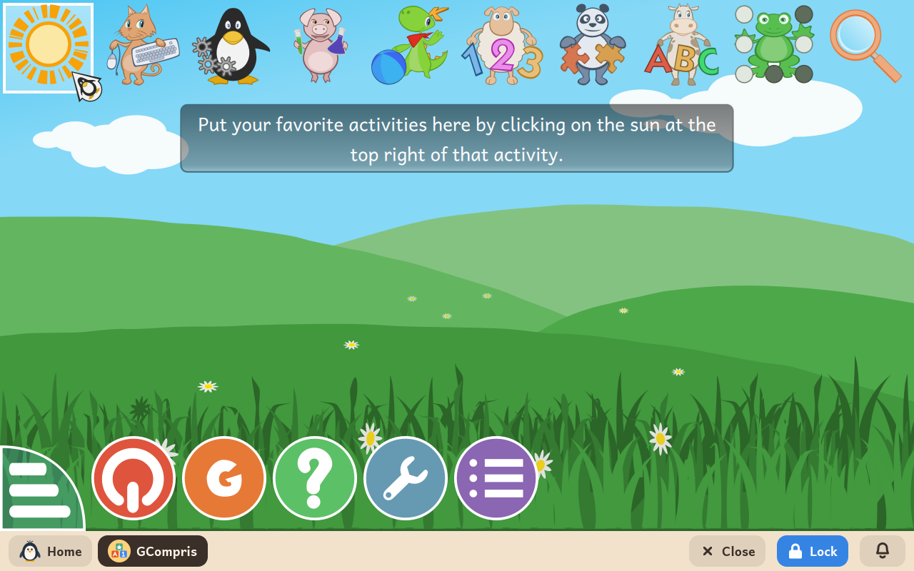

Pour en savoir plus : [la page de GCompris](modules/gcompris.md).

### Tux Typing

**Tux Typing** apprend à un enfant à taper au clavier. Des lettres et des
mots tombent du ciel, et l'enfant attrape chacun en le tapant, un niveau
plus difficile à chaque fois. Ses menus sont dans la langue de l'enfant, et
les mots qui tombent aussi : un enfant francophone attrape des mots
français. Il est destiné aux enfants de six à douze ans. GCompris, qui
apprend d'abord les lettres du clavier, est un bon début avant lui. Son
menu **Leçons** contient le cours de dactylographie de Kidux : en
français, quinze leçons pour le clavier AZERTY, qui apprennent à taper
avec les dix doigts, une rangée à la fois, et dont les trois dernières
apportent les lettres accentuées. Dans chaque exercice, le clavier dessiné ne porte que les
touches qu'on est en train de travailler.

Tux Typing garde ses scores et ses réglages pour lui, pas dans les dossiers
de l'enfant. Supprimer le module les conserve pour son retour.

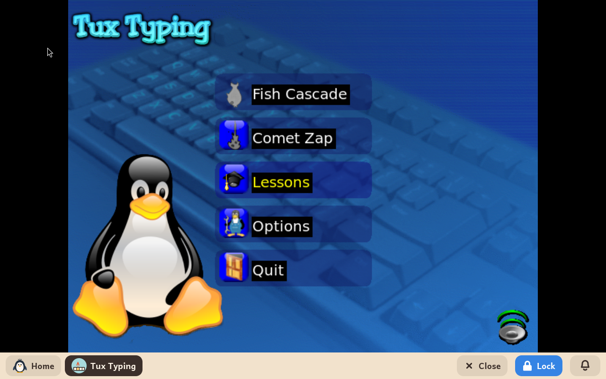

Pour en savoir plus : [la page de Tux Typing](modules/tuxtype.md).

### ScratchJr

**ScratchJr**, c'est Scratch pour les plus petits, de cinq à sept ans. Des
personnages bougent, parlent et jouent quand l'enfant assemble des blocs
illustrés, sans un mot à lire. C'est l'application du MIT elle-même, telle
que sa communauté l'a portée sur ordinateur, et elle apporte sa propre
copie d'un moteur de navigateur web : environ 380 Mo.

Les projets de l'enfant sont gardés dans un dossier de ses **Documents**,
**ScratchJR**, que ScratchJr crée la première fois qu'il est ouvert.
Supprimer le module les y laisse.

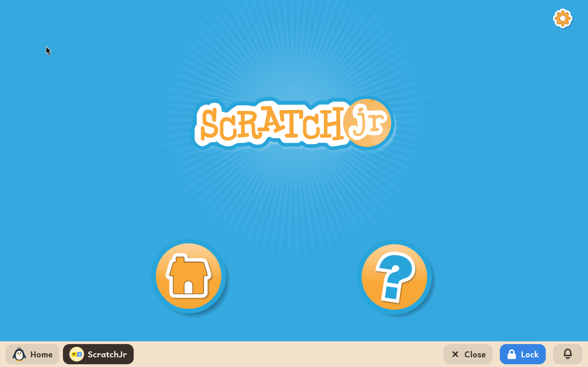

Pour en savoir plus : [la page de ScratchJr](modules/scratchjr.md).

### Blockly Games

**Blockly Games**, ce sont des énigmes qui apprennent les idées de la
programmation avec des blocs, un cran plus difficile à chaque fois :
guider un personnage dans un labyrinthe, faire voler un oiseau, dessiner
avec une tortue, faire un film et faire de la musique. Elles sont destinées
aux enfants de six à douze ans qui lisent un peu. Elles sont dans la langue
de l'enfant, et fonctionnent sans Internet. Les jeux se souviennent de
l'endroit où l'enfant en est arrivé, et supprimer le module le conserve
pour son retour.

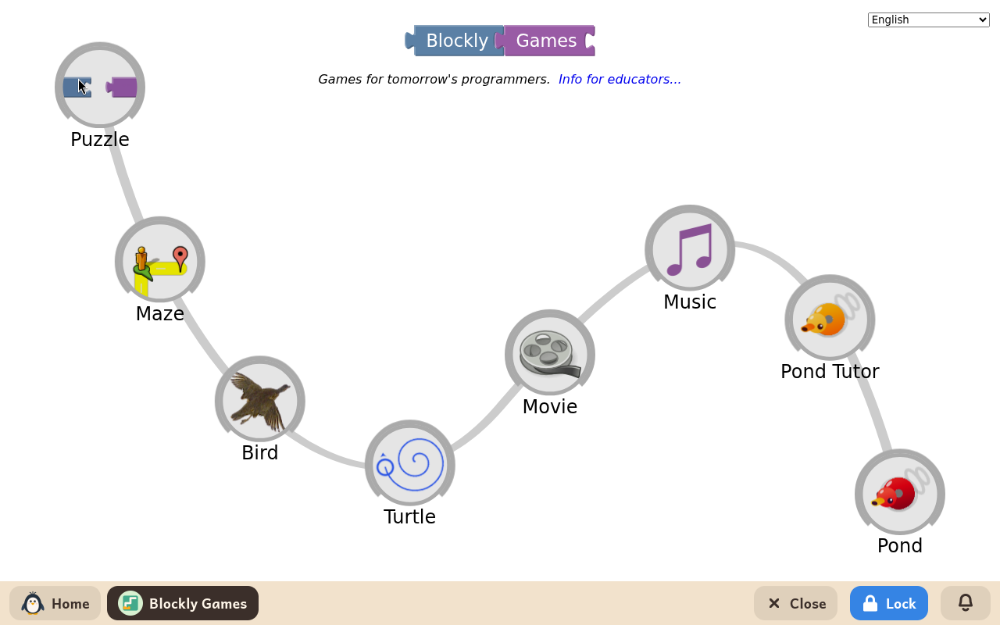

Pour en savoir plus : [la page de Blockly Games](modules/blockly-games.md).

### Scratch

**Scratch** est l'éditeur que les enfants utilisent à l'école pour faire
des jeux, des histoires et des animations en assemblant des blocs. C'est
l'éditeur de Scratch lui-même, dans la langue de l'enfant, sans la
communauté du site de Scratch : rien de ce que fait un enfant n'est
partagé, et personne d'autre ne peut le voir. Il est destiné aux enfants à
partir de huit ans. ScratchJr, pour les plus jeunes, est un bon début avant
lui.

Sa bibliothèque de personnages, d'arrière-plans et de sons vient des
serveurs de la Scratch Foundation quand un enfant l'ouvre ; il lui faut donc
Internet à ce moment-là. Tout le reste fonctionne sans. Les vidéos des
tutoriels ne se lisent pas : elles sont sur un site web, et un module ne
montre que ses propres pages.

Pour garder un projet, l'enfant choisit **Fichier**, puis **Sauvegarder
sur votre ordinateur**. Une fenêtre des dossiers de l'enfant s'ouvre, dans
**Téléchargements**, pour choisir où garder le projet et sous quel nom, et
**Enregistrer** le garde. **Fichier**, puis **Charger depuis votre
ordinateur**, ouvre la même fenêtre pour y choisir un projet. Un projet
enregistré depuis Scratch s'ouvre aussi dans TurboWarp, et inversement.

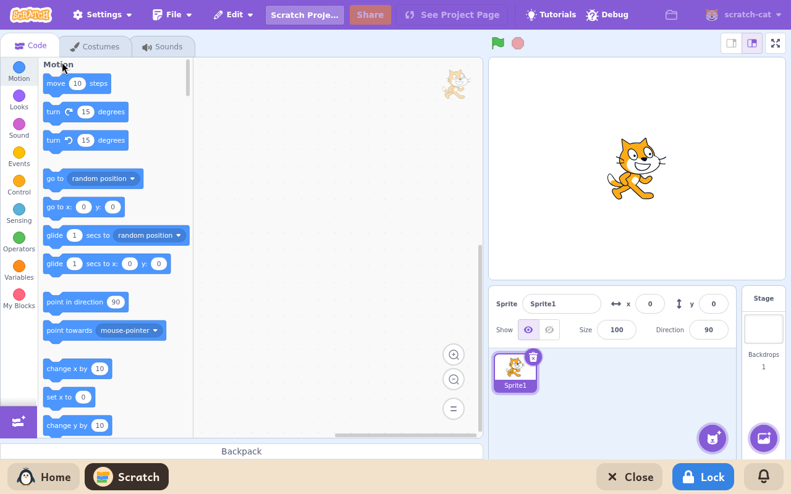

Pour en savoir plus : [la page de Scratch](modules/scratch.md).

### TurboWarp

**TurboWarp**, c'est Scratch en plus rapide : le même éditeur, les mêmes
blocs et les mêmes fichiers de projet, avec un compilateur qui fait tourner
les projets bien plus vite. Choisissez-le à la place de Scratch sur un
ordinateur lent, ou quand Scratch ne tourne pas bien sur celui-ci. Ce qui
est dit plus haut de Scratch vaut aussi pour TurboWarp : sa bibliothèque
vient d'Internet, et un projet est gardé dans les dossiers de l'enfant,
choisi dans une fenêtre, et rouvert depuis eux. Un projet ne s'ouvre qu'à
partir d'un fichier. TurboWarp ne peut pas en récupérer un sur le site de
Scratch par son numéro.

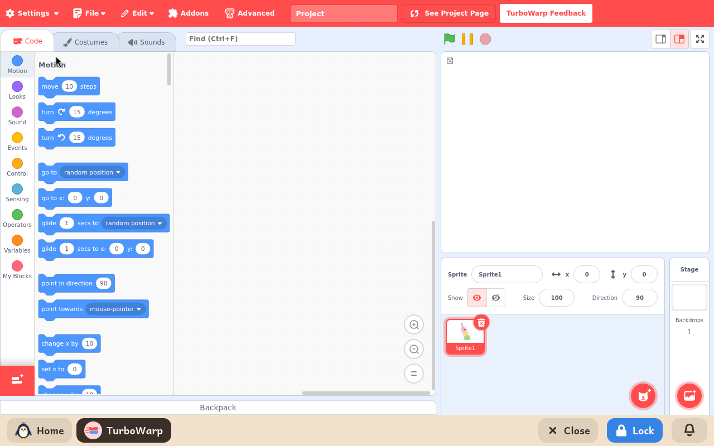

Pour en savoir plus : [la page de TurboWarp](modules/turbowarp.md).

### BASIC

**BASIC** est le langage que parlaient les premiers ordinateurs familiaux,
et c'est toujours une bonne façon de commencer à écrire des programmes. Le
module est un petit ordinateur de cette époque à gauche, et un guide pour
s'en servir à droite. Il est destiné aux enfants de huit à quatorze ans qui
lisent bien, dans la langue de l'enfant, et il n'a besoin de rien sur
Internet.

La moitié gauche a trois parties : l'éditeur en haut, où l'enfant écrit le
programme ; une rangée de boutons ; et l'écran en dessous, où le programme
montre ce qu'il fait. **Lancer** lance le programme, tout comme
Ctrl+Entrée. Un programme qui ne se termine jamais s'arrête avec
**Arrêter**, ou avec Échap. Quand une ligne contient une erreur, le texte
sous l'écran dit quelle ligne, et l'éditeur la signale.

La moitié droite est le guide, un chapitre à la fois, avec **Précédent**,
**Suivant** et la liste des **Chapitres**. L'enfant y lit un programme et
le tape dans l'éditeur. Le bouton sous chaque programme le tape à sa place,
sauf si un adulte a désactivé *Tape-le pour moi* pour l'enfant dans les
**Réglages** de BASIC de l'espace adulte, pour que l'enfant tape lui-même
chaque programme. Les trente chapitres vont d'un premier `PRINT` au dessin,
à la couleur, au son et à des jeux à garder. Chaque chapitre se termine par
des idées pour continuer à essayer, et un encadré **Pour l'adulte** qui dit
ce que le chapitre enseigne.

Le programme de l'éditeur y reste quand BASIC est fermé, jusqu'à ce que
l'enfant appuie sur **Nouveau**. Pour garder un programme, **Enregistrer**
ouvre une fenêtre des dossiers de l'enfant, dans **Téléchargements**, pour
choisir où le garder et sous quel nom, sous forme de fichier `.bas`.
**Ouvrir** ouvre la même fenêtre pour en rouvrir un.

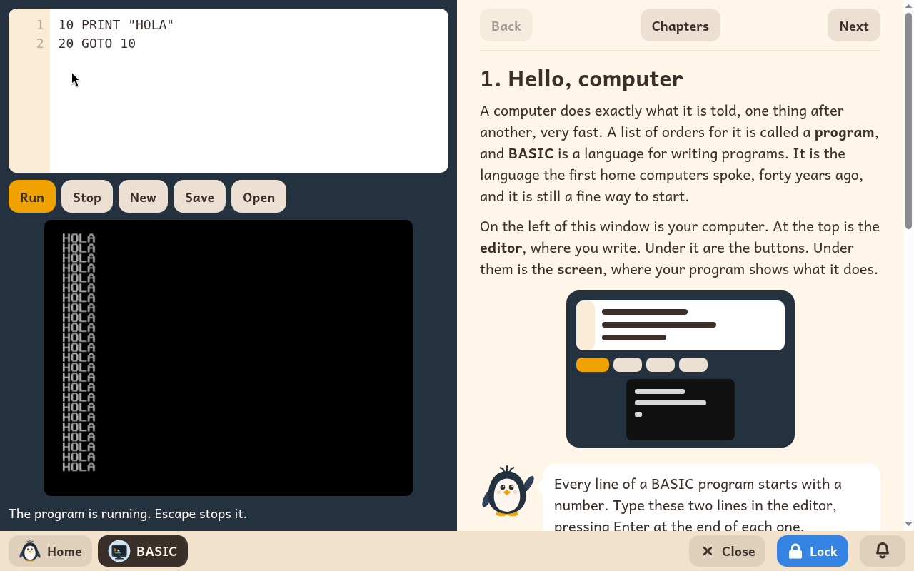

Pour en savoir plus : [la page de BASIC](modules/basic.md).

### CodeCombat

**CodeCombat** est une porte vers le site de CodeCombat, où les enfants à
partir de neuf ans apprennent à écrire du vrai Python et du vrai JavaScript
en jouant : un héros parcourt chaque niveau comme le lui dit le programme
de l'enfant. Le site appartient à CodeCombat, il est dans la langue de
l'enfant, et le module l'ouvre, lui et aucun autre site. Kidux n'a aucun
lien avec CodeCombat.

Il a besoin d'Internet, et d'un compte CodeCombat. Les premiers niveaux
sont gratuits. La plus grande partie du site demande un abonnement, qu'un
adulte achète sur un autre ordinateur, puisque le module n'ouvre aucun
autre site.

Un adulte indique le compte de chaque enfant dans les **Réglages** de
CodeCombat de l'espace adulte : son adresse e-mail et son mot de passe. Le
module connecte alors l'enfant de lui-même chaque fois qu'il est ouvert, en
affichant *Connexion à CodeCombat…* pendant ce temps. Il met la langue du
site dans celle de l'enfant et ouvre l'endroit où le jeu commence. L'enfant
ne voit jamais le mot de passe. Quand le compte est faux ou que le site ne
répond pas, le module le dit et propose de réessayer.

Si aucun compte n'est indiqué, le module dit que le plus simple est qu'un
adulte le renseigne dans l'espace adulte, et propose en attendant un bouton
pour se connecter à la main. Ce bouton ouvre la fenêtre de connexion du
site, où l'enfant tape l'adresse e-mail et le mot de passe du compte. Se
connecter avec Google, Facebook ou Clever ne mène nulle part ici. Le site
peut poser une question sur ses cookies la première fois ; c'est la
question du site lui-même.

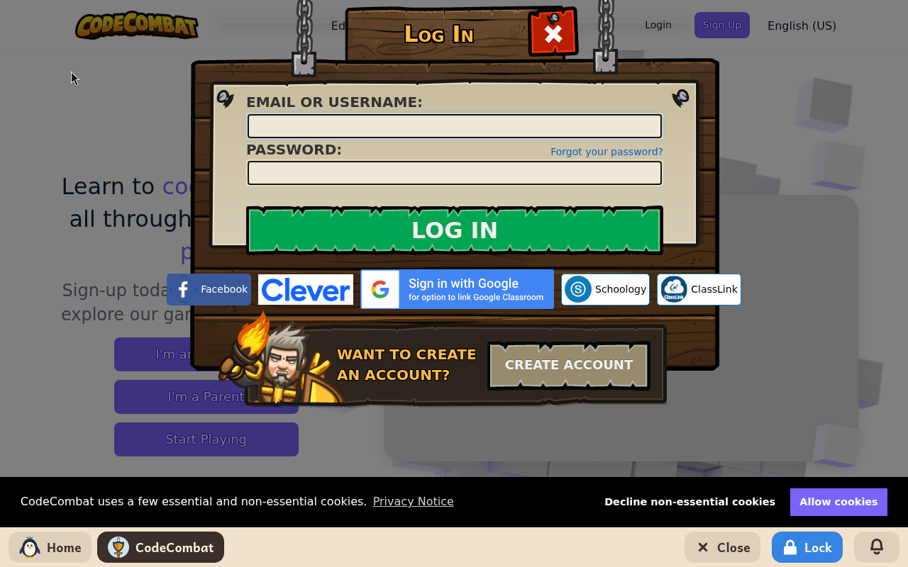

Pour en savoir plus : [la page de CodeCombat](modules/codecombat.md).

### Wikipédia

**Wikipédia** est une porte vers l'encyclopédie entière, dans la langue de
l'enfant, et vers les projets vers lesquels elle renvoie, comme le
Wiktionnaire et Wikilivres. C'est Wikipédia telle que tout le monde la lit,
écrite pour tout le monde et pas seulement pour les enfants ; c'est donc un
adulte qui décide si un enfant la lit, à partir de huit ans. Un lien qui
sort de Wikipédia et de ses projets ne mène nulle part.

Une barre en haut de la fenêtre a **Précédent** et **Suivant**, qui vont à
la page d'avant et à la page d'après. Ils sont grisés quand il n'y a nulle
part où aller. **Alt+Gauche**, et le bouton « précédent » d'une souris qui
en a un, reviennent aussi en arrière. Wikipédia a besoin d'Internet chaque
fois qu'elle est utilisée.

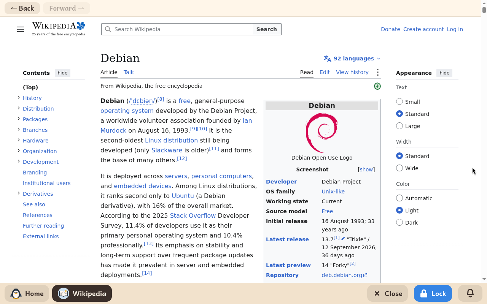

Pour en savoir plus : [la page de Wikipédia](modules/wikipedia.md).

### Messagerie

**Messagerie** est une boîte aux lettres à l'enfant, dans Thunderbird, le
programme de messagerie, pour les enfants à partir de huit ans. L'enfant y
lit et y écrit ses messages, et n'a rien à configurer : le compte est celui
qu'un adulte lui donne. Elle fonctionne avec Gmail, Outlook, iCloud et tout
autre fournisseur qui parle IMAP. Il lui faut Internet pour envoyer et
recevoir.

Un adulte indique le compte dans les **Réglages** de Messagerie de l'espace
adulte : l'**Adresse e-mail** de l'enfant, et le **Nom** sous lequel
partent ses messages. Messagerie trouve d'elle-même les serveurs du
fournisseur pour Gmail, Outlook, Hotmail, iCloud, Yahoo et la plupart des
autres. Pour un fournisseur qu'elle ne trouve pas, **Serveur entrant** et
**Serveur sortant** prennent les serveurs IMAP et SMTP du fournisseur, tels
qu'il les donne, par exemple `imap.example.org`. Un serveur sur un port
particulier s'écrit avec le port, par exemple `imap.example.org:143`.

L'adulte ouvre ensuite Messagerie avec l'enfant la première fois. Pour un
compte Gmail ou Outlook, la fenêtre de connexion de Google ou de Microsoft
s'ouvre dans Messagerie. L'adulte s'y connecte, avec la seconde étape si le
compte en a une, et Messagerie reste connectée. Pour tout autre
fournisseur, Messagerie demande le mot de passe une fois. L'adulte le tape,
avec la case pour le retenir cochée, et Messagerie le garde. Le mot de
passe reste dans la partie de l'ordinateur propre à l'enfant, que personne
d'autre sur l'ordinateur ne peut lire. L'espace adulte ne l'a jamais.

Le compte Google d'un enfant de moins de treize ans est supervisé avec
Family Link, et Google ne laisse pas un tel compte se connecter à
Messagerie. Pour lui, c'est le module **Gmail** qu'il faut.

Ce que l'enfant change dans le compte est remis en place la prochaine fois
que Messagerie s'ouvre, et un compte ajouté à la main disparaît : le compte
est toujours celui indiqué dans l'espace adulte. Sans adresse dans l'espace
adulte, ou avec un fournisseur que Messagerie ne trouve pas et aucun
serveur indiqué, Messagerie s'ouvre avec seulement ses dossiers locaux.

Un lien dans un message ne mène nulle part. Une pièce jointe est
enregistrée dans les **Téléchargements** de l'enfant, et jamais ouverte
avec un autre programme. Le tchat de Messagerie, ses modules
complémentaires et ses réglages avancés sont fermés. Quand un serveur ne
répond pas, Messagerie le dit dans une bulle au-dessus de la barre, et dans
la ligne en bas de sa fenêtre.


Pour en savoir plus : [la page de Messagerie](modules/mail.md).

### Gmail

**Gmail** est une porte vers le site de Gmail, pour un enfant qui a un
compte Google, à partir de huit ans. C'est Gmail tel qu'il est sur
n'importe quel ordinateur, dans la langue de l'enfant, et le module
l'ouvre, lui et aucun autre site : un lien qui en sort ne mène nulle part.
C'est le module pour un enfant de moins de treize ans, dont le compte
Google est supervisé avec Family Link et ne peut pas se connecter à
**Messagerie**. Il convient à n'importe quel compte Google, pour une famille
qui préfère le site. Kidux n'a aucun lien avec Google. Il a besoin
d'Internet chaque fois qu'il est utilisé.

Un adulte indique le compte Google de l'enfant dans les **Réglages** de
Gmail de l'espace adulte, comme **Adresse e-mail**. La page de connexion de
Google s'ouvre alors avec l'adresse déjà écrite. L'adulte ouvre Gmail avec
l'enfant la première fois et s'y connecte, avec le mot de passe et, si
Google la demande, la seconde étape. Gmail reste connecté ensuite. Le
fermer, quitter la session ou éteindre l'ordinateur ne déconnecte pas
l'enfant, et Google ne redemande que quand il le décide. Le mot de passe
n'est tapé que dans la page de Google ; l'espace adulte ne l'a jamais. Le
site peut poser une question sur ses cookies la première fois ; c'est la
question de Google lui-même.


Pour en savoir plus : [la page de Gmail](modules/gmail.md).

### Kig

**Kig**, c'est de la géométrie qu'un enfant peut faire bouger. Des points,
des droites, des cercles et des figures se placent sur le plan, et chacun
garde sa règle quand l'enfant déplace ce à partir de quoi il a été
construit : le milieu reste au milieu, et la parallèle reste parallèle. Il
est destiné aux enfants de dix à quatorze ans, dans la langue de l'enfant,
et il fonctionne sans Internet. Ce qu'un enfant dessine peut être enregistré
dans un fichier de ses dossiers. Il est accompagné d'un guide de six
leçons.


Pour en savoir plus : [la page de Kig](modules/kig.md).

### Kalzium

**Kalzium**, c'est le tableau périodique. Chaque élément s'ouvre sur ce à
quoi il ressemble, l'endroit où il a été découvert, une photo et un dessin
de son atome. Un curseur montre quels éléments sont solides, liquides ou
gazeux à n'importe quelle température, et il y a un glossaire des mots. Il
est destiné aux enfants à partir de dix ans, dans la langue de l'enfant, et
il fonctionne sans Internet. Il est accompagné d'un guide de trois leçons.


Pour en savoir plus : [la page de Kalzium](modules/kalzium.md).

### Step

**Step** est un terrain de jeu de physique. L'enfant place des corps, des
ressorts, des cordes et des forces sur le plan, lance la simulation et
regarde ce qui se passe, avec des instruments de mesure et des graphiques
pour le lire. Les exemples de son menu Fichier sont des expériences prêtes à
lancer. Il est destiné aux enfants à partir de dix ans, dans la langue de
l'enfant, et il fonctionne sans Internet. Son menu pour télécharger
d'autres expériences est désactivé. Une expérience peut être enregistrée
dans un fichier des dossiers de l'enfant. Il est accompagné d'un guide de
six leçons.


Pour en savoir plus : [la page de Step](modules/step.md).

### Simulations

**Simulations**, ce sont des expériences avec lesquelles jouer à l'écran :
construire un nombre, équilibrer une balançoire, courber un rayon de
lumière, frotter un ballon sur un pull, construire un atome, mettre des
planètes en orbite. Ce sont les simulations interactives de PhET, créées
par l'Université du Colorado à Boulder et utilisées dans les écoles du
monde entier. Kidux les a choisies pour les enfants de six à quatorze ans
et les a classées par groupe et par âge, dans la langue de l'enfant. Elles
sont sur l'ordinateur et fonctionnent sans Internet. Chacune s'ouvre dans
son propre cadre, avec **Simulations** en haut pour revenir à la liste. Les
simulations sont les versions que PhET a publiées sous la licence Creative
Commons Attribution 4.0. Kidux n'a aucun lien avec PhET.


Pour en savoir plus : [la page de Simulations](modules/simulations.md).

### Photographie

**Photographie** est un guide pour prendre des photos avec un vrai appareil
photo, pour les enfants de huit à douze ans qui lisent bien, dans la langue
de l'enfant. Il n'a besoin de rien sur Internet, mais il lui faut un
appareil : n'importe quel appareil avec une molette ou un menu pour ses
modes, qu'il soit compact, bridge ou reflex, et pour commencer, même un
téléphone. L'exemple du guide est l'Olympus XZ-2. L'encadré **Sur
l'appareil Olympus XZ-2** de chaque chapitre dit quel bouton, quelle
molette ou quel menu fait ce que le chapitre enseigne, et que les autres
appareils ont la même chose sous d'autres noms.

Les trente chapitres commencent par une boîte noire percée d'un trou, ce
qu'est toujours tout appareil photo. Ils continuent avec l'objectif,
l'obturateur, l'ouverture et la sensibilité ISO ; les modes de l'appareil,
et pourquoi le mode manuel est le plus fiable sous une lumière stable ; la
façon dont l'appareil mesure la lumière et l'endroit où il fait la mise au
point ; la profondeur de champ, la photo de près et le zoom. Viennent
ensuite la composition, la lumière, la couleur et les personnes. Les
derniers chapitres parlent de regarder les photos et de les choisir. Chaque
chapitre a des photos de son effet, des dessins de ce que montre l'écran de
l'appareil, un **Essaie** à faire avec l'appareil le jour même, et des
idées pour continuer à essayer. Un encadré **Pour l'adulte** dit ce que le
chapitre enseigne et ce pour quoi aider : une pièce sombre, une lampe de
poche, le flash, une rue au crépuscule.

**Précédent**, **Suivant** et la liste des **Chapitres** permettent de se
déplacer dans le guide. La plupart des photos sont des photos libres
d'autres personnes, chacune créditée en dessous. Quand aucune ne montrait
clairement un effet, une image créée par un ordinateur le montre, et le dit
en dessous.


Pour en savoir plus : [la page de Photographie](modules/photography.md).

## 10. Mises à jour et réinstallation

Les mises à jour s'installent d'elles-mêmes, chaque matin et en
arrière-plan. Elles comprennent les mises à jour de sécurité de Debian et
celles de Kidux, et il n'y a rien à faire pour les recevoir. Tant qu'un
enfant est dans sa session, les mises à jour attendent, et elles
s'installent une fois que le dernier enfant a quitté la sienne, pour que
rien de ce qu'utilise un enfant ne change entre-temps. Si un enfant essaie
d'entrer pendant qu'elles s'installent, l'écran lui dit que l'ordinateur se
met à jour, et il peut entrer un moment plus tard.

Les mises à jour de Kidux viennent de `apt.kidux.org`, un serveur du
projet. Comme tout serveur web, il enregistre chaque requête avec l'adresse
d'où elle vient, et ces enregistrements indiquent au projet combien
d'ordinateurs font tourner Kidux et quels modules ils installent. La
requête dit qu'elle vient d'un ordinateur Kidux et rien de plus : ni nom, ni
version, rien qui concerne un enfant. **Partager les statistiques
d'utilisation**, dans la page Système, rubrique Avancé, ajoute un
identifiant créé pour cet ordinateur seul, afin qu'il soit compté comme un
ordinateur plutôt que comme une adresse ; il est activé tant que vous ne le
désactivez pas.

Si vous voulez les installer tout de suite, sans attendre le lendemain
matin, utilisez la page **Système** de l'espace adulte :

1. Appuyez sur **Chercher des mises à jour**. La page indique combien il y
   a de mises à jour, et lesquelles.
2. Appuyez sur **Installer**. Une barre montre où en est l'installation.
3. Si une mise à jour demande de redémarrer l'ordinateur, la page le dit,
   avec **Redémarrer maintenant**.

Les mises à jour ne s'installent que lorsqu'aucun enfant n'a de session
ouverte, pour que rien de ce qu'utilise un enfant ne change sous ses yeux.
La page le signale si un enfant a une session ouverte.


## 11. En cas de problème

### Kidux ne démarre pas

L'ordinateur garde la façon de démarrer propre à Debian derrière le mot de
passe de secours, celui qu'affiche la page **Système** de l'espace adulte.

1. Allumez l'ordinateur, et appuyez une ou deux fois sur Échap pendant la
   première seconde, avant que le logo n'apparaisse. Un menu s'affiche.
2. Le menu demande un nom d'utilisateur et un mot de passe. Le nom
   d'utilisateur est `kidux`. Le mot de passe est le mot de passe de
   secours.
3. Choisissez la première entrée Debian.

L'ordinateur démarre comme une Debian ordinaire, sans les écrans de Kidux.
Quelqu'un qui connaît Debian peut alors chercher ce qui ne va pas.

### Un administrateur a besoin d'une connexion en mode texte

Kidux désactive les connexions en mode texte, car une invite de connexion
sur l'ordinateur d'un enfant est une porte d'entrée. Pour en retrouver une
le temps d'une réparation :

1. Ouvrez le menu comme ci-dessus.
2. Appuyez sur `e` sur l'entrée **Kidux**.
3. Ajoutez `kidux.console` à la fin de la ligne qui commence par `linux`.
4. Appuyez sur F10.

Les connexions en mode texte reviennent pour ce démarrage seulement.

### L'ordinateur ne se met pas en veille

Un administrateur avec une connexion en mode texte (ci-dessus), ou par SSH,
peut voir ce que l'ordinateur sait faire et ce qu'il a fait :

```sh
busctl call org.freedesktop.login1 /org/freedesktop/login1 \
    org.freedesktop.login1.Manager CanSuspend
systemd-inhibit --list                # ce qui le maintient allumé
journalctl -b | grep -i suspend
```

`yes` ou `challenge` à la première commande veut dire qu'il peut se mettre
en veille. Le journal dit pourquoi il ne l'a pas fait pour le capot :
`sudo journalctl -t kidux-daemon | grep -i lid`. Kidux met l'ordinateur en
veille quand il voit le capot se fermer, et pas quand un autre écran est
branché ou que le capot est déjà rouvert.

### Retirer Kidux d'un ordinateur

Supprimez le paquet `kidux-session` et redémarrez. L'ordinateur redevient
une machine Debian ordinaire. Les comptes des enfants, leurs fichiers et
chaque réglage restent, si bien que Kidux peut être remis plus tard
exactement comme il était.

## 12. Obtenir de l'aide

Ouvrez une demande (« issue ») sur la page GitHub du projet, en anglais ou
en espagnol.
